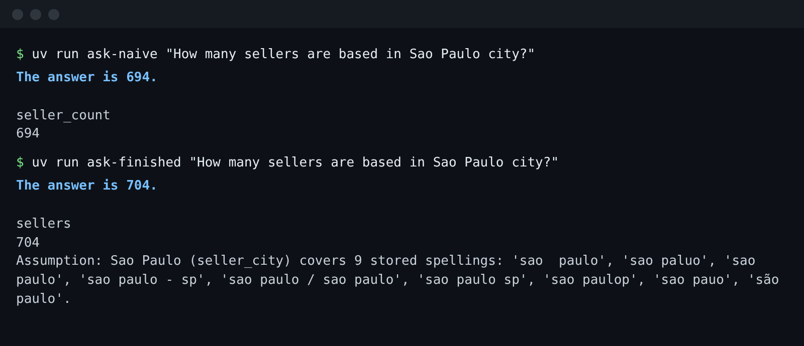

# Meet the desk

## The problem

The seller-success lead asked the desk's chatbot how many sellers are based in Sao Paulo city. It answered 694.
The lead was about to plan a big programme for every seller in the city, based on that number.

A wrong count that looks right costs more than a count that fails. Nobody checks a number that looks fine.



## Your challenge

Ask both agents the same question. Write down both counts. Then say in one sentence why they are different.

1. Run `uv run ask-naive "How many sellers are based in Sao Paulo city?"`.
2. Run `uv run ask-finished "How many sellers are based in Sao Paulo city?"` and read its `Assumption:` line.
3. Create `notes/first-look.md` in this folder with three lines:

```
Naive: <the naive agent's count>
Finished: <the finished agent's count>
Gap: <one sentence: why the counts differ>
```

For example, here is a `Gap:` line for a different golden question, `customers-in-sao-paulo`. Your question is about
sellers, so you write your own line.

```
Gap: the naive agent counted orders, but the question asked for people.
```

## Done when

- `bun run world` has built the database, and every table has the row count of the fixed download.
- `notes/first-look.md` exists in this folder.
- The `Naive:` and `Finished:` numbers are the ones the agents printed. The check works out both numbers from the
  database, so a guess fails.
- The `Gap:` line has at least five words.

```bash
bun run verify meet-the-desk
```

Expect: `Done. All 5 rules pass.` and a `Progress:` line.

## If you get stuck

| What you see                      | Fix                                                                                         |
| --------------------------------- | ------------------------------------------------------------------------------------------- |
| `FAIL the world is built`         | Run `bun run world reset`. It builds `data/olist.db` again from the saved download.         |
| `FAIL notes/first-look.md exists` | Create the file inside `00-orientation/01-meet-the-desk/problem/notes/`, not the repo root. |
| `FAIL a Naive: line holds ...`    | Copy the number the naive agent printed. Start the line with `Naive:`.                      |
| `FAIL a Finished: line holds ...` | Copy the finished agent's number. It counts every spelling of the city.                     |
| `FAIL a Gap: line ...`            | Read the finished agent's assumption. Say what the naive agent missed.                      |

## Words you will use

- **Agent**: a program that asks a model what to do, runs tools (here, SQL), and gives an answer.
- **Replay mode**: the model's replies come from recorded files. So the course runs with no key, and every run gives
  the same result.
- **Golden set**: test questions, each with a reference query that a person checked by hand. `world/golden.toml`
  holds 30.
- **System of record**: the place whose numbers count as the truth. Here it is `data/olist.db`.
