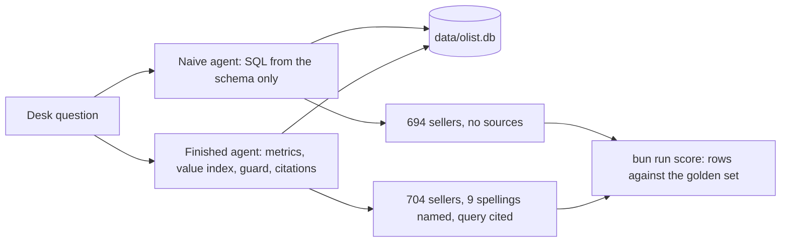
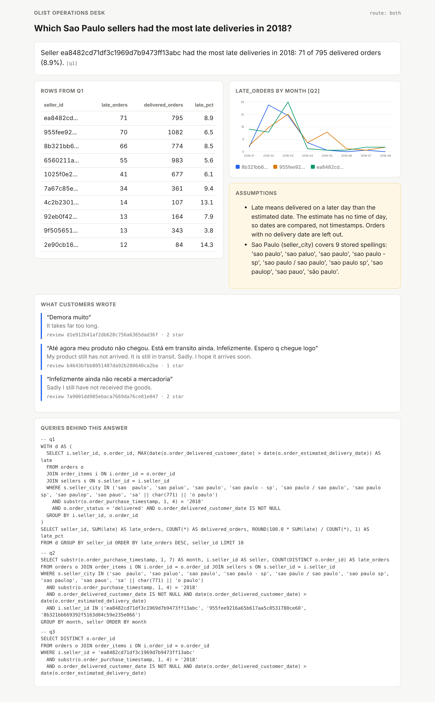

# Start here: meet the desk

You join the operations desk of Olist. Olist is a Brazilian marketplace. It lists the products of small sellers on
large shopping sites. Two kinds of people send the desk questions:

- category managers, who own the sales and quality of one product category;
- seller-success leads, who help sellers start, coach them, and sometimes pause them.

Today a chatbot answers their questions.

For example, the seller-success lead asked the chatbot: "How many sellers are based in Sao Paulo city?" It said
694. That looks right. It is wrong, and nobody noticed.

In this orientation you do five things:

1. You set up the repo.
2. You meet the data.
3. You run the finished agent. This is the agent you will build.
4. You run the naive agent. This is the simple agent you start from.
5. You see the gap between them with your own eyes.



## What you need

- Bun 1.4.4 or later (bun.sh) and uv (docs.astral.sh/uv). uv also installs the Python version this repo needs.
- No model key. Everything here runs in replay mode. In replay mode the agents answer from recorded replies in
  `world/replay/`.
- Later you may want a live model. Then copy `.env.example` to `.env`, set `LLM_PROVIDER` and one key, and run
  `uv run models`.

## Walkthrough

Install the tools for both languages.

```bash
bun install && uv sync
```

Expect: both finish with no error. `uv sync` ends with a line like `Installed 62 packages`.

Now build the world. The command downloads the Olist files from a fixed copy. It checks each file's SHA-256, a
fingerprint that changes if one byte changes. Then it builds the database `data/olist.db`. The data is never stored
in this repo. Read [world/README.md](../world/README.md) for the source and the licence.

```bash
bun run world
```

Expect: one line per table, including `orders 99441` and `sellers 3095`, then `Read-only open: ok, a DELETE was refused.`

Run the finished system first, so you know where you are going. The `--html` option also saves the answer as a web
page.

```bash
uv run ask-finished "Which Sao Paulo sellers had the most late deliveries in 2018?" --html answer.html
```

Expect: `Seller ea8482cd71df3c1969d7b9473ff13abc had the most late deliveries in 2018: 71 of 795 delivered orders (8.9%).`, a table, two `Assumption:` lines, three Portuguese reviews with English glosses, and `Wrote answer.html`.

Open `answer.html` in your browser. Look at three things:

- Every number shows the query behind it.
- Every quote shows its `review_id`.
- The assumptions say what "late" and "Sao Paulo" mean.



Now ask both agents the seller-success lead's question.

```bash
uv run ask-naive "How many sellers are based in Sao Paulo city?"
```

Expect: `The answer is 694.` and nothing else: no assumption, no source.

```bash
uv run ask-finished "How many sellers are based in Sao Paulo city?"
```

Expect: `The answer is 704.` and an `Assumption:` line that lists the 9 stored spellings of the city.

The `Assumption:` line looks like this. It names every way the city is written in the data:

```
Assumption: Sao Paulo (seller_city) covers 9 stored spellings: 'sao  paulo', 'sao paluo', 'sao paulo', 'sao paulo - sp', 'sao paulo / sao paulo', 'sao paulo sp', 'sao paulop', 'sao pauo', 'são paulo'.
```

Next, score the naive agent on all 30 golden questions. A golden question is a test question with an answer that a
person checked by hand. The scorer runs a reference query for each one, and compares its rows with the agent's rows.

```bash
bun run score naive
```

Expect: one `MATCH` or `MISS` line per question, then `Score: 14 of 30 match.`

Write down what you saw. Then run the check.

```bash
bun run verify meet-the-desk
```

Expect: `Done. All 5 rules pass.` once `notes/first-look.md` is written (see the step below).

## Your one step here

[meet-the-desk](01-meet-the-desk/problem/README.md): write down the two counts and the reason they are different.

## The goal of the course

By the end, your agent passes the golden set, refuses every request to change data, and hands off what it does not
own. The finished agent scores `30 of 30` with the same scorer (`bun run score finished`). The naive one scores
`14 of 30`.

Did a command print something you did not expect? Look it up in [troubleshooting.md](troubleshooting.md).
