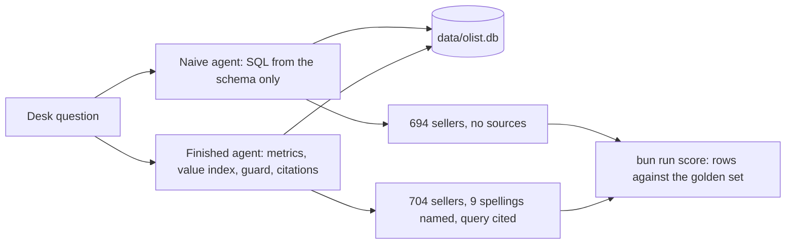

# Start here: meet the desk

You join the operations desk of Olist, a Brazilian marketplace that lists small sellers' products on large retail
sites. Category managers and seller-success leads send the desk questions about sellers, orders and reviews. A
chatbot answers them today.

The seller-success lead asked it: "How many sellers are based in Sao Paulo city?" It said 694. It reads as right.
It is not, and nobody noticed. In this orientation you set up the repo, meet the data, run the finished agent you
will build, run the naive one you start from, and see the gap with your own eyes.



## What you need

- Bun 1.4.4 or later (bun.sh) and uv (docs.astral.sh/uv). uv installs the Python this repo pins.
- No model key. Everything here runs in replay mode: the agents answer from recorded replies in `world/replay/`.
  When you want a live model, copy `.env.example` to `.env`, set `LLM_PROVIDER` and one key, and run `uv run models`.

## Walkthrough

Install both toolchains.

```bash
bun install && uv sync
```

Expect: both finish with no error. `uv sync` ends with a line like `Installed 62 packages`.

Build the world. It downloads the Olist files from a pinned copy, checks each file's SHA-256, and builds
`data/olist.db`. The data is never stored in this repo; see [world/README.md](../world/README.md) for the source and the licence.

```bash
bun run world
```

Expect: one line per table, including `orders 99441` and `sellers 3095`, then `Read-only open: ok, a DELETE was refused.`

Run the finished system first, so you know where you are going. `--html` also writes the answer as a page.

```bash
uv run ask-finished "Which Sao Paulo sellers had the most late deliveries in 2018?" --html answer.html
```

Expect: `Seller ea8482cd71df3c1969d7b9473ff13abc had the most late deliveries in 2018: 71 of 795 delivered orders (8.9%).`, a table, two `Assumption:` lines, three Portuguese reviews with English glosses, and `Wrote answer.html`.

Open `answer.html` in your browser. Every number has the query behind it, every quote has its `review_id`, and the
assumptions say what "late" and "Sao Paulo" mean.


Now ask both agents the seller-success lead's question.

```bash
uv run ask-naive "How many sellers are based in Sao Paulo city?"
```

Expect: `The answer is 694.` and nothing else: no assumption, no source.

```bash
uv run ask-finished "How many sellers are based in Sao Paulo city?"
```

Expect: `The answer is 704.` and an `Assumption:` line that lists the 9 stored spellings of the city.

Score the naive agent on all 30 golden questions. Each answer is judged by its rows against a reference query.

```bash
bun run score naive
```

Expect: one `MATCH` or `MISS` line per question, then `Score: 14 of 30 match.`

Write down what you saw, then check it.

```bash
bun run verify meet-the-desk
```

Expect: `Done. All 5 rules pass.` once `notes/first-look.md` is written (see the step below).

## Your one step here

[meet-the-desk](01-meet-the-desk/problem/README.md): write the two counts and the reason they differ.

## The goal of the course

Make your agent pass the golden set, refuse every write, and hand off what it does not own. The finished agent
scores `30 of 30` on the same scorer (`bun run score finished`); the naive one scores `14 of 30`.

When a command prints something you do not expect, look it up in [troubleshooting.md](troubleshooting.md).
