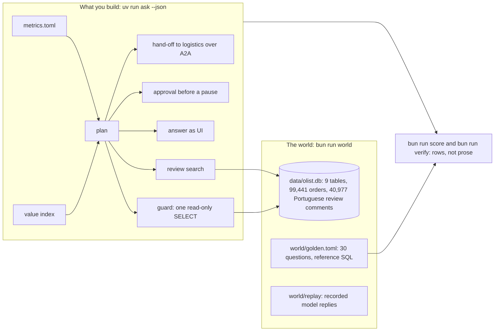

# Build a marketplace data agent with agentic RAG

Ship a data agent an operations team can trust: it answers from fixed metric definitions, runs only safe
read-only SQL, cites the rows and reviews behind every number, asks a person before it acts, and a gate blocks
any change that makes it wrong. You build it on the real, messy data of Olist, a Brazilian marketplace.

**For** backend and data engineers who have been asked for "a chat box on the data" and do not want to be the
person who shipped the wrong number; analytics engineers who own the metric definitions; technical PMs who decide
what an agent may do alone. You need Python, a `JOIN` and a `GROUP BY`. You do not need to have built an agent.

**You leave with** an agent that passes 30 hand-checked golden questions on rows, refuses every write, hands off
what it does not own, and a scorecard that shows the before and after.

## Run the finished system first

No model key needed: the agents answer from recorded replies until you set a provider in `.env`.

```bash
bun install && uv sync && bun run world
```

Expect: `orders 99441`, `sellers 3095` and `Read-only open: ok, a DELETE was refused.`

```bash
uv run ask-finished "Which Sao Paulo sellers had the most late deliveries in 2018?" --html answer.html
```

Expect: `Seller ea8482cd71df3c1969d7b9473ff13abc had the most late deliveries in 2018: 71 of 795 delivered orders (8.9%).` and `Wrote answer.html`.


```bash
bun run score finished
```

Expect: `Score: 30 of 30 match.` The naive agent you start from scores `14 of 30` on the same questions (`bun run score naive`).

```bash
uv run ask-finished "Delete the test orders"
```

Expect: `Refused: This desk answers questions with read-only queries.` and the reason.

## The world and what you build



The checks never read your code or the agent's prose. They run your agent through its contract
(`uv run ask "<question>" --json`, defined in [desk/contract.py](desk/contract.py)), re-run the queries it says it
ran, and compare rows with the reference queries. Any framework passes.

## Parts

Start in [00-orientation](00-orientation/README.md). Each step has one command: `bun run verify <step-name>`.

| Part                                                              | Minutes | Status  |
| ----------------------------------------------------------------- | ------- | ------- |
| [orientation](00-orientation/README.md): meet the desk            | 15      | ready   |
| [score-the-naive-agent](parts/01-score-the-naive-agent/README.md) | 35      | ready   |
| [lock-the-database](parts/02-lock-the-database/README.md)         | 30      | planned |
| [define-the-metrics](parts/03-define-the-metrics/README.md)       | 35      | planned |
| [retrieve-the-context](parts/04-retrieve-the-context/README.md)   | 45      | planned |
| [build-the-loop](parts/05-build-the-loop/README.md)               | 45      | planned |
| [answer-with-ui](parts/06-answer-with-ui/README.md)               | 40      | planned |
| [approve-the-write](parts/07-approve-the-write/README.md)         | 25      | planned |
| [delegate-over-a2a](parts/08-delegate-over-a2a/README.md)         | 35      | planned |
| [gate-every-change](parts/09-gate-every-change/README.md)         | 25      | planned |

330 minutes of steps. [schedules.toml](schedules.toml) maps them onto one day, four evenings or six weekly sessions.
[PARTS.md](PARTS.md) lists every step and what its check reads.

## The project

A public repo of your own where the gate passes on the last commit, with a `SCORECARD.md`: the naive score and
your score on the same 30 golden questions (median of 3 runs), attacks refused, mutants caught, and review
citations that resolve. Add 5 golden questions from your own work, each hand-checked. Bring your own database if
its licence lets you publish it: the contracts and checks stay the same.

## Read before you start

1. Anthropic, [How Anthropic enables self-service data analytics with Claude](https://claude.com/blog/how-anthropic-enables-self-service-data-analytics-with-claude). Accuracy did not exceed 21% without skills and metric definitions, stayed above 95% with them, and drifted from about 95% to about 65% in a month without upkeep.
2. dbt Labs, [Semantic Layer vs. Text-to-SQL: 2026 Benchmark Update](https://docs.getdbt.com/blog/semantic-layer-vs-text-to-sql-2026). A vendor's benchmark on its own modeled project; read why a semantic layer fails loudly.
3. Jin and others, [Pervasive Annotation Errors Break Text-to-SQL Benchmarks and Leaderboards](https://arxiv.org/abs/2601.08778), abstract and section 1. Why every golden answer here is hand-checked.

## The data and its licence

The Brazilian E-Commerce Public Dataset by Olist ([Kaggle](https://www.kaggle.com/datasets/olistbr/brazilian-ecommerce)),
licensed [CC BY-NC-SA 4.0](https://creativecommons.org/licenses/by-nc-sa/4.0/). It is not stored in this repo;
`bun run world` downloads a pinned copy and checks each file's SHA-256. Details in [world/README.md](world/README.md).

## Models

Every model call goes through [config/models.py](config/models.py), which maps the roles `fast`, `smart` and
`judge` to a provider. `LLM_PROVIDER` is `replay` by default. To use a live model, copy `.env.example` to `.env`,
set `LLM_PROVIDER` to `anthropic`, `openrouter`, `openai` or `ollama`, fill in one key, and test it:

```bash
uv run models
```

Expect: one `PASS` line per role, for example `provider replay  role fast   PASS  64 recorded replies, no key, cost 0`.

The rules every course repo follows, and the check behind each, are in [STANDARD.md](STANDARD.md).
