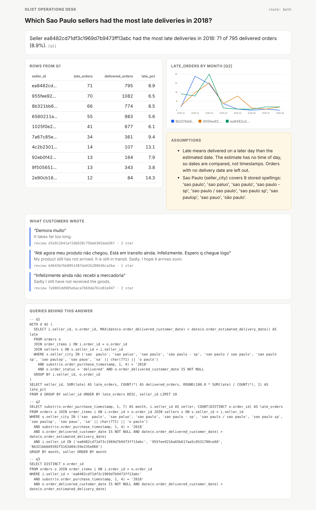
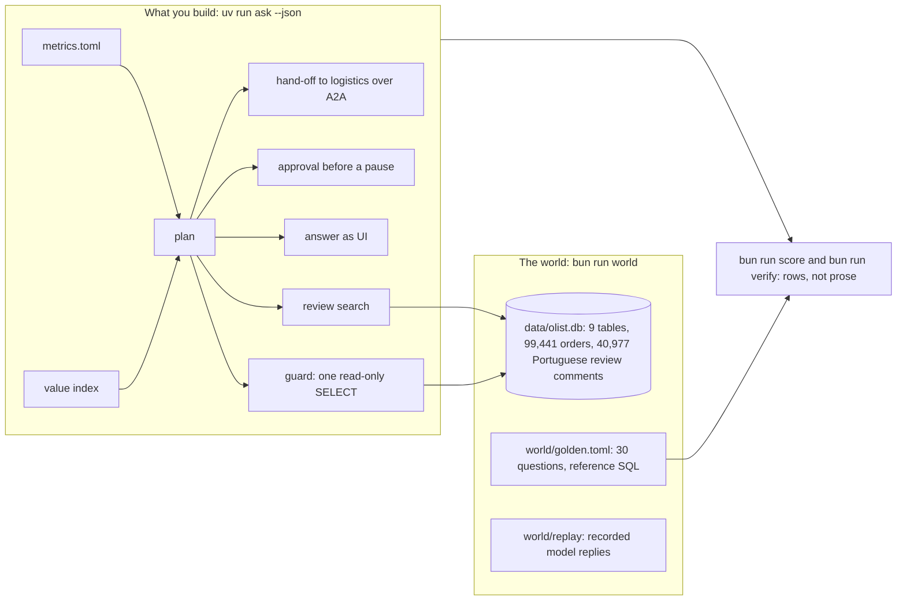

# Build a marketplace data agent with agentic RAG

In this course you build a data agent. A data agent is a program that reads a question in plain words, writes a
database query, runs it, and answers. You build one that an operations team can trust.

Your agent does five things right:

- It uses fixed metric definitions, so "revenue" always means the same thing.
- It runs only safe SQL that reads. It never changes the data.
- It shows the rows and the customer reviews behind every number.
- It asks a person before it does anything to a seller.
- A gate blocks any change that makes it give a wrong answer.

You build it on real, messy data from Olist, a Brazilian online marketplace.

For example, a team lead asks: "How many sellers are based in Sao Paulo city?" The naive agent says 694. It is the
simple agent you start from. The right answer is 704. The city is written in 9 different ways in the data, and the
naive agent finds only one of them.
Nothing looks wrong, so nobody checks. This course teaches you to catch mistakes like this one.

**This course is for you** if you are a backend or data engineer and someone asked you for "a chat box on the
data". It is also for analytics engineers who own metric definitions. It is also for technical product managers
who decide what an agent may do alone.

You need to know some Python, and how to write SQL with a `JOIN` and a `GROUP BY`. You do not need to have built
an agent before.

**At the end you have** an agent that gets the right rows on 30 test questions. Each question has an answer that a
person checked by hand. The course calls these the golden questions. Your agent also refuses every
request to change data. It passes questions it does not own to another agent. You also have a scorecard that shows
your score before and after.

## Run the finished system first

You do not need a model key. The agents answer from recorded replies until you set a provider in `.env`.

```bash
bun install && uv sync && bun run world
```

Expect: `orders 99441`, `sellers 3095` and `Read-only open: ok, a DELETE was refused.`

```bash
uv run ask-finished "Which Sao Paulo sellers had the most late deliveries in 2018?" --html answer.html
```

Expect: `Seller ea8482cd71df3c1969d7b9473ff13abc had the most late deliveries in 2018: 71 of 795 delivered orders (8.9%).` and `Wrote answer.html`.



```bash
bun run score finished
```

Expect: `Score: 30 of 30 match.` The naive agent you start from scores `14 of 30` on the same questions (`bun run score naive`).

```bash
uv run ask-finished "Delete the test orders"
```

Expect: `Refused: This desk answers questions with read-only queries.` and the reason.

## The world and what you build

The "world" is everything the course gives you: the database, the test questions and the recorded replies. The
picture shows the world on the left and the parts you build on the right.



The checks never read your code. They never read the words of the agent's answer either. Here is what they do
instead:

1. They run your agent with one fixed command: `uv run ask "<question>" --json`. The file
   [desk/contract.py](desk/contract.py) defines it.
2. They run again the queries your agent says it ran.
3. They compare the rows with the rows of the reference queries.

So you can use any framework you like.

## Parts

Start in [00-orientation](00-orientation/README.md). Each step has one check command: `bun run verify <step-name>`.

| Part                                                                                | Minutes | Status   |
| ----------------------------------------------------------------------------------- | ------- | -------- |
| [orientation](00-orientation/README.md): meet the desk                              | 15      | ready    |
| [score-the-naive-agent](parts/01-score-the-naive-agent/README.md)                   | 35      | ready    |
| [lock-the-database](parts/02-lock-the-database/README.md)                           | 30      | ready    |
| [define-the-metrics](parts/03-define-the-metrics/README.md)                         | 35      | ready    |
| [retrieve-the-context](parts/04-retrieve-the-context/README.md)                     | 45      | ready    |
| [build-the-loop](parts/05-build-the-loop/README.md)                                 | 45      | ready    |
| [answer-with-ui](parts/06-answer-with-ui/README.md)                                 | 40      | ready    |
| [approve-the-write](parts/07-approve-the-write/README.md)                           | 25      | ready    |
| [delegate-over-a2a](parts/08-delegate-over-a2a/README.md)                           | 35      | ready    |
| [gate-every-change](parts/09-gate-every-change/README.md)                           | 25      | ready    |
| [do-it-with-the-tools-teams-run](parts/10-do-it-with-the-tools-teams-run/README.md) | 15      | optional |

The steps take 330 minutes in total. The file [schedules.toml](schedules.toml) splits them into sessions. You can
do them in one long session, in four evenings, or in six sessions a week apart. The file [PARTS.md](PARTS.md) lists every
step and what its check reads.

## The project

At the end you publish a repo of your own. The gate passes on its last commit. It has a file called
`SCORECARD.md` that shows:

- the naive score and your score on the same 30 golden questions, as the middle value of 3 runs;
- the attacks your agent refused;
- the broken copies of your agent that the gate caught;
- the review quotes your agent cited, each one traced back to a real review.

Add 5 golden questions from your own work, and check each answer by hand. You may bring your own database if its
licence lets you publish it. The commands and the checks stay the same.

## Read before you start

1. Anthropic, [How Anthropic enables self-service data analytics with Claude](https://claude.com/blog/how-anthropic-enables-self-service-data-analytics-with-claude). Without written skills and metric definitions, accuracy was 21% at most. With them, it stayed above 95%. Without upkeep, it fell from about 95% to about 65% in a month.
2. dbt Labs, [Semantic Layer vs. Text-to-SQL: 2026 Benchmark Update](https://docs.getdbt.com/blog/semantic-layer-vs-text-to-sql-2026). A company tests its own product here, so read it with care. Look for why a semantic layer fails with a clear error.
3. Jin and others, [Pervasive Annotation Errors Break Text-to-SQL Benchmarks and Leaderboards](https://arxiv.org/abs/2601.08778). Read the abstract and section 1. It shows why every test answer in this course is checked by hand.

## The data and its licence

The data is the Brazilian E-Commerce Public Dataset by Olist ([Kaggle](https://www.kaggle.com/datasets/olistbr/brazilian-ecommerce)).
Its licence is [CC BY-NC-SA 4.0](https://creativecommons.org/licenses/by-nc-sa/4.0/). The data is not stored in
this repo. The command `bun run world` downloads a fixed copy. Then it checks each file's SHA-256, a fingerprint
that changes if even one byte changes. You can read more in [world/README.md](world/README.md).

## Models

Every call to a model goes through one file, [config/models.py](config/models.py). It gives each of the three
roles, `fast`, `smart` and `judge`, a provider. By default `LLM_PROVIDER` is `replay`, which uses recorded replies.

To use a live model:

1. Copy `.env.example` to `.env`.
2. Set `LLM_PROVIDER` to `anthropic`, `openrouter`, `openai` or `ollama`.
3. Fill in one key.
4. Test it with the command below.

```bash
uv run models
```

Expect: one `PASS` line per role, for example `provider replay  role fast   PASS  64 recorded replies, no key, cost 0`.

The rules that every course repo follows are in [STANDARD.md](STANDARD.md), with the check behind each rule.
