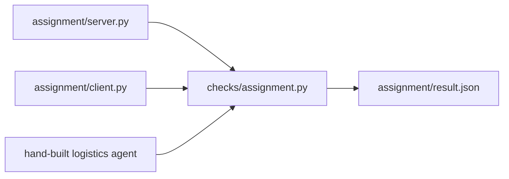

# Assignment: replace your hand-built A2A server with the official SDK

Optional in the live session. Expected as homework.

## The task

In delegate-over-a2a you served an agent with a hand-built A2A server. Replace it with the official
`a2a-sdk` 1.3.0. The agent function stays the same. Only the server changes.

The starter is `server.py` in this folder. It imports the SDK and the agent function, and serves nothing yet.
`client.py` is ready. The steps are in
[serve-with-the-sdk](../parts/10-do-it-with-the-tools-teams-run/01-serve-with-the-sdk/problem/README.md).
This folder has no compose file, because the course needs no containers.

Write `CHOICE.md` as well: two sentences on when you would use ADK's A2A support instead of the SDK.



## Done when

The check script tests each line:

- `a2a-sdk` resolves to 1.3.0.
- The agent card validates.
- The three course queries return the same answers as part 08.

```bash
uv run checks/assignment.py
```

Expect: three `PASS` lines and `Wrote assignment/result.json: 3 of 3 pass.` On the untouched starter you see `FAIL` lines.

## Hand in

Push a branch named `assignment` and send its URL. The grader runs the same check script.

## Rubric (we read it)

- No agent logic was copied into `server.py`; it calls the agent function.
- `CHOICE.md` says when ADK's A2A support is the better pick.
- The executor returns what the function returns and adds nothing.
