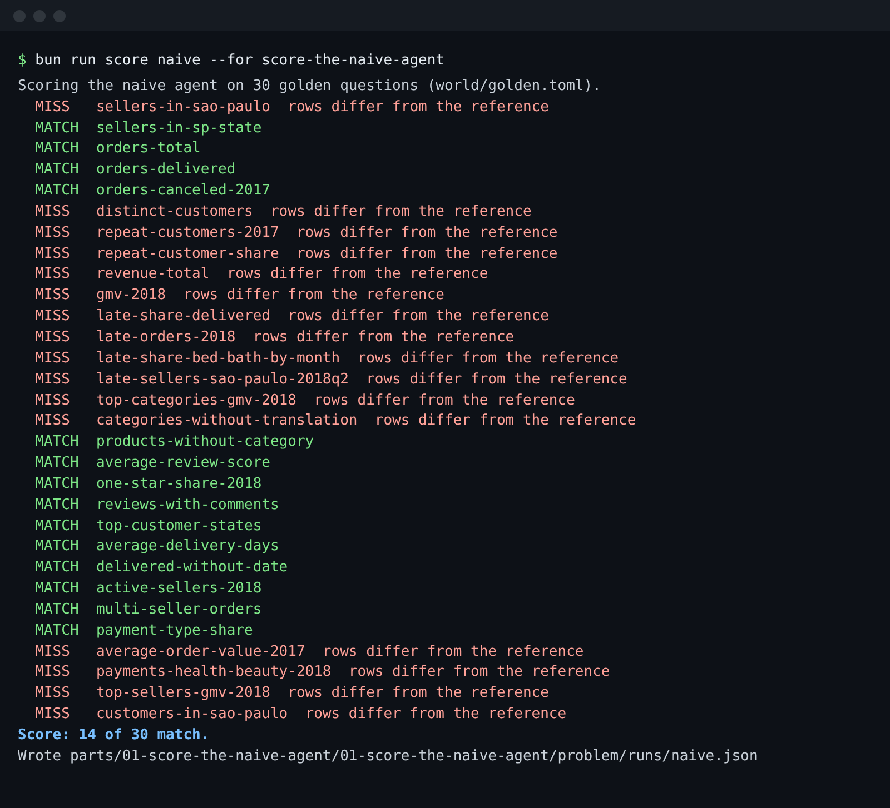

# Score the naive agent

## The problem

Nobody on the desk knows how often the chatbot is wrong. Each wrong answer looked fine on its own. Without a
score, every later fix is a guess, and nobody can tell whether a change made the agent better or worse.



## Your challenge

Run the provided scorer on the naive agent and read its output. The scorer sends each of the 30 golden questions
to the agent through its contract (`uv run ask-naive "<question>" --json`), runs the reference query from
`world/golden.toml`, and compares the two sets of rows.

```bash
bun run score naive --for score-the-naive-agent
```

Expect: 30 `MATCH` or `MISS` lines and `Score: 14 of 30 match.`

Then open `runs/naive.json` in this folder. For one `MISS`, find the `sql` the agent ran and the reference `sql`
in `world/golden.toml`. They return different rows. Notice that two queries can look different and still match:
the scorer ignores column names, column order and rounding past 2 places.

## Done when

- `runs/naive.json` exists in this folder.
- It holds one result for each of the 30 golden questions.
- Every answer names the query its rows came from, and re-running that query on the database gives the same rows.
- Every `match` flag agrees with the check's own row comparison, and the score counts the matches.

```bash
bun run verify score-the-naive-agent
```

Expect: `Done. All 6 rules pass.`

## If you get stuck

| What you see                                       | Fix                                                                                           |
| -------------------------------------------------- | --------------------------------------------------------------------------------------------- |
| `FAIL runs/naive.json exists`                      | Run the scorer with `--for score-the-naive-agent`; without it the file goes to the repo root. |
| `FAIL it has one result for every golden question` | Let the scorer finish; do not stop it or edit the file.                                       |
| `FAIL re-running each recorded query ...`          | The rows were edited. Run the scorer again.                                                   |
| `FAIL every match flag agrees ...`                 | The file was judged some other way, for example by SQL text. Run the scorer again.            |
| `uv: command not found`                            | Install uv, open a new terminal, run the scorer again.                                        |

## Words you will use

- **Reference query**: the hand-checked SQL whose rows define the right answer to a golden question.
- **Result match**: two answers agree when their rows agree, whatever SQL produced them.
- **Contract**: the command and JSON shape an agent must answer, so any language or framework can be scored.
