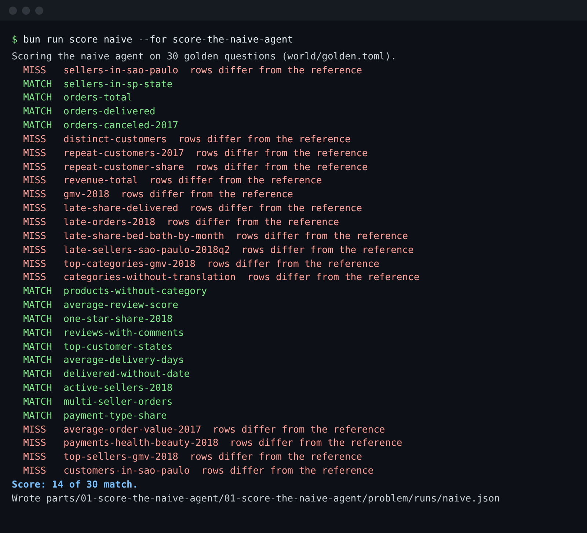

# Score the naive agent

## The problem

Nobody on the desk knows how often the chatbot is wrong. Each wrong answer looked fine on its own. Without a score, every fix is a guess. Nobody can tell if a change made the agent better or worse.



## Your challenge

Run the scorer that comes with the course on the naive agent. Then read what it prints.

For each of the 30 golden questions, the scorer does three things:

1. It asks the agent with one fixed command: `uv run ask-naive "<question>" --json`.
2. It runs the reference query from `world/golden.toml`. A person checked this query by hand. Its rows are the right answer.
3. It compares the two sets of rows.

```bash
bun run score naive --for score-the-naive-agent
```

Expect: 30 `MATCH` or `MISS` lines and `Score: 14 of 30 match.`

Then open `runs/naive.json` in this folder. Pick one `MISS`. Find the `sql` the agent ran. Then find the reference `sql` in `world/golden.toml`. The two return different rows.

For example, the first miss in the output is a `MISS` line for `sellers-in-sao-paulo`. It says the rows differ from the reference. In `runs/naive.json`, the agent's query for it is:

```sql
SELECT COUNT(*) AS seller_count FROM sellers WHERE seller_city = 'sao paulo'
```

It returns `694`. The reference query lists all 9 spellings of the city. It returns `704`.

Two queries can look different and still match. The scorer ignores column names and column order. It also ignores digits after the second decimal place.

## Done when

- `runs/naive.json` exists in this folder.
- It holds one result for each of the 30 golden questions.
- Every answer names the query its rows came from. Running that query again on the database gives the same rows.
- Every `match` flag agrees with the check's own row comparison. The score counts the matches.

```bash
bun run verify score-the-naive-agent
```

Expect: `Done. All 6 rules pass.`

## If you get stuck

| What you see                                       | Fix                                                                                            |
| -------------------------------------------------- | ---------------------------------------------------------------------------------------------- |
| `FAIL runs/naive.json exists`                      | Run the scorer with `--for score-the-naive-agent`. Without it, the file goes to the repo root. |
| `FAIL it has one result for every golden question` | Let the scorer finish. Do not stop it or edit the file.                                        |
| `FAIL re-running each recorded query ...`          | The rows were edited. Run the scorer again.                                                    |
| `FAIL every match flag agrees ...`                 | The file was judged some other way, for example by SQL text. Run the scorer again.             |
| `uv: command not found`                            | Install uv. Open a new terminal. Run the scorer again.                                         |

## Words you will use

- **Reference query**: the hand-checked SQL. Its rows define the right answer to a golden question.
- **Result match**: two answers agree when their rows agree. Their SQL can be different.
- **Contract**: the command an agent must answer, and the JSON shape it must print. So you can score an agent written in any language or framework.
