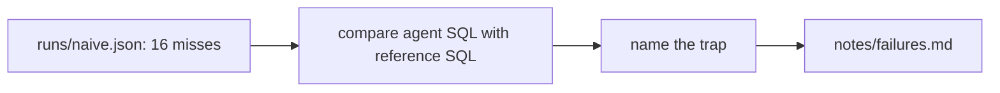

# Read the failures

## The problem

A score says how often the agent is wrong, not why. Anthropic reports that Claude answered business analytics
questions with at most 21% accuracy before its team wrote down metric definitions and data skills, and about 95%
after ([Anthropic](https://claude.com/blog/how-anthropic-enables-self-service-data-analytics-with-claude)). You
only know which fix to build once you know which trap each miss fell into.



## Your challenge

This folder ships with `runs/naive.json`, the scored run from the previous step. For each `MISS`, compare the
agent's `sql` with the reference `sql` and the `note` in `world/golden.toml`, and name the trap. Write
`notes/failures.md` with one line per miss:

```
- sellers-in-sao-paulo: spelling, it matched one spelling of the city.
```

Use one of these labels (they are explained at the top of `world/golden.toml`): `spelling`, `customer-id`,
`fan-out`, `undefined-metric`, `date-text`, `status-filter`, `translation`. When a miss has two causes, pick the
one you would fix first. The words after the comma are yours; the check does not read them.

## Done when

- `notes/failures.md` exists in this folder.
- Every question the run misses has a line: a dash, the question id, a colon, a label.
- Every label is one of the seven, and it is a trap that question can fall into.
- No line names a question the agent got right.

```bash
bun run verify read-the-failures
```

Expect: `Done. All 6 rules pass.`

## If you get stuck

| What you see | Fix |
|---|---|
| `FAIL every failed question has a line` | Search the run for `"match": false` and list each `id`. |
| `FAIL each label is a trap that question can fall into` | Read that question's `traps` and `note` in `world/golden.toml`. |
| `FAIL no line names a question the agent got right` | Remove lines for questions marked `MATCH`. |

## Words you will use

- **Fan-out**: a join that repeats rows, so a `SUM` or `COUNT` comes out too large.
- **Error analysis**: reading failures one by one and naming their causes before you change anything.
