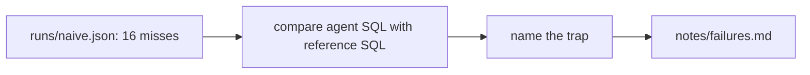

# Read the failures

## The problem

A score says how often the agent is wrong. It does not say why.

Anthropic wrote down metric definitions and data skills for Claude. Before that, Claude got at most 21% of business
data questions right. After that, it got about 95% right
([Anthropic](https://claude.com/blog/how-anthropic-enables-self-service-data-analytics-with-claude)). The fix came
from knowing the cause.

A trap is something in the data that makes a simple query give a wrong answer. You know which fix to build only
when you know which trap each miss fell into.



## Your challenge

This folder already has `runs/naive.json`, the scored run from the previous step. For each `MISS`, do this:

1. Read the agent's `sql` in the run.
2. Read the reference `sql` and the `note` in `world/golden.toml`.
3. Name the trap.

Write `notes/failures.md` with one line per miss.

For example, the first miss is `sellers-in-sao-paulo`. The agent's query ends with
`WHERE seller_city = 'sao paulo'`. The `note` in `world/golden.toml` says the city has nine spellings in the data.
So the trap is `spelling`, and the line looks like this:

```
- sellers-in-sao-paulo: spelling, it matched one spelling of the city.
```

Use one of these labels: `spelling`, `customer-id`, `fan-out`, `undefined-metric`, `date-text`, `status-filter`,
`translation`. The top of `world/golden.toml` explains each one.

Some misses have two causes. Then pick the one you would fix first. The words after the comma are yours. The
check does not read them.

## Done when

- `notes/failures.md` exists in this folder.
- Every question the run misses has a line. The line has a dash, the question id, a colon and a label.
- Every label is one of the seven, and it is a trap that question can fall into.
- No line names a question the agent got right.

```bash
bun run verify read-the-failures
```

Expect: `Done. All 6 rules pass.`

## If you get stuck

| What you see                                            | Fix                                                             |
| ------------------------------------------------------- | --------------------------------------------------------------- |
| `FAIL every failed question has a line`                 | Search the run for `"match": false` and list each `id`.         |
| `FAIL each label is a trap that question can fall into` | Read that question's `traps` and `note` in `world/golden.toml`. |
| `FAIL no line names a question the agent got right`     | Remove lines for questions marked `MATCH`.                      |

## Words you will use

- **Fan-out**: a join that repeats rows, so a `SUM` or `COUNT` comes out too large. For example, an order with
  three items shows up three times after a join to `order_items`.
- **Error analysis**: you read the failures one by one, and name their causes, before you change anything.
