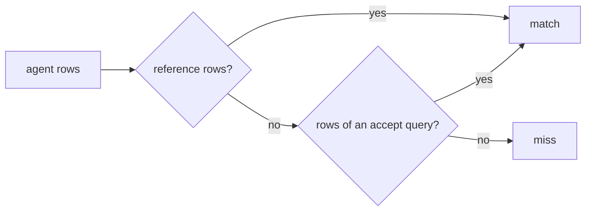

# Accept many answers

## The problem

Some questions have more than one honest answer. For example, "What is our total revenue?" has two in this data:

- the payments received: 16,008,872.12;
- the item prices plus the freight: 15,843,553.24.

Freight is the cost of shipping. GMV, the total value of goods sold, also has two answers: with freight or without
it.

The business has not picked one definition yet. So a golden set that accepts only one answer marks a fair answer
wrong. Then the score lies. LinkedIn found that 60% of its test questions had more than one accepted answer
([LinkedIn Engineering](https://www.linkedin.com/blog/engineering/ai/practical-text-to-sql-for-data-analytics)).

Be careful not to accept a wrong total. Then the score lies the other way: it marks a wrong answer right.



## Your challenge

This folder has its own `golden.toml` and the naive run. In `golden.toml`, give `revenue-total` and `gmv-2018`
an `accept` list. An `accept` list holds other queries whose rows also count as right. Put the other fair
definition in it. Keep each `sql` as it is.

For example, this line goes under `revenue-total`:

```toml
accept = ["SELECT ROUND(SUM(price + freight_value), 2) AS revenue FROM order_items"]
```

For `gmv-2018`, the other fair answer is the item price without freight, for orders placed in 2018. You write
that query yourself. Then score the naive agent against your file:

```bash
bun run score naive --for accept-many-answers
```

Expect: `Score: 16 of 30 match.` The two questions now print `MATCH (accept 1)`.

## Done when

- `golden.toml` here still has all 30 questions, and both reference queries stay the same.
- `revenue-total` and `gmv-2018` each accept at least one query. Each accepted query runs.
- Every accepted query gives a fair definition that is different from the reference.
- No other question changed. The naive run now matches both questions.
- A wrong total still fails. For example, a total from payments joined to items counts some payments twice. It
  must match neither question.

```bash
bun run verify accept-many-answers
```

Expect: `Done. All 7 rules pass.`

## If you get stuck

| What you see                                                 | Fix                                                          |
| ------------------------------------------------------------ | ------------------------------------------------------------ |
| `FAIL ... keep their reference query`                        | Put `sql` back and add the alternative under `accept`.       |
| `FAIL ... a fair definition that differs from the reference` | Accept only the other definition, not a copy and not a join. |
| `FAIL a wrong total still fails`                             | Remove any accepted query that joins payments to items.      |
| A TOML error                                                 | Use `"""` around a query that spans lines.                   |

## Words you will use

- **GMV**: gross merchandise value. It is the value of everything sold, before cancellations and refunds.
- **Accepted answer**: another query whose rows also count as right, until the business picks one definition.
