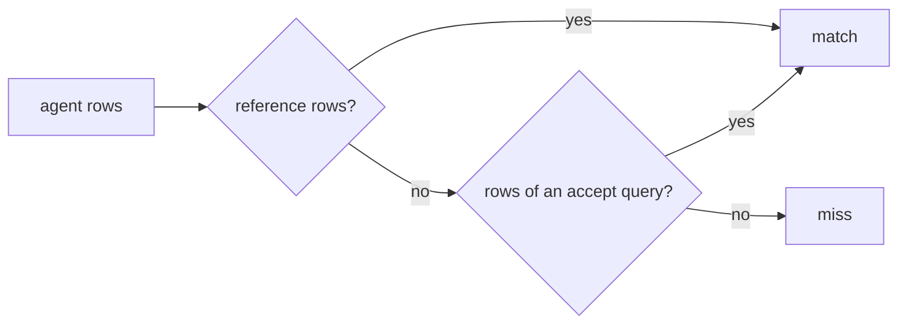

# Accept many answers

## The problem

"What is our total revenue?" has two honest answers in this data: payments received (16,008,872.12) and item
price plus freight (15,843,553.24). GMV is the same: with or without freight. Until the business picks one
definition, a golden set that accepts only one marks a fair answer wrong, and the score lies. LinkedIn found 60%
of its benchmark questions had more than one accepted answer
([LinkedIn Engineering](https://www.linkedin.com/blog/engineering/ai/practical-text-to-sql-for-data-analytics)).
Accepting a wrong total is worse: then the score lies the other way.



## Your challenge

This folder holds its own `golden.toml` and the naive run. In `golden.toml`, give `revenue-total` and `gmv-2018`
an `accept` list with the other fair definition. Keep each `sql` as it is.

```toml
accept = ["SELECT ROUND(SUM(price + freight_value), 2) AS revenue FROM order_items"]
```

GMV's alternative is item price without freight, for orders placed in 2018. Then score the naive agent against
your file:

```bash
bun run score naive --for accept-many-answers
```

Expect: `Score: 16 of 30 match.` The two questions now print `MATCH (accept 1)`.

## Done when

- `golden.toml` here keeps all 30 questions, and both reference queries are unchanged.
- `revenue-total` and `gmv-2018` each accept at least one query, and each accepted query runs.
- Every accepted query returns a fair definition that differs from the reference.
- No other question changed, and the naive run now matches both questions.
- A wrong total still fails: the fan-out totals (payments joined to items) match neither question.

```bash
bun run verify accept-many-answers
```

Expect: `Done. All 7 rules pass.`

## If you get stuck

| What you see | Fix |
|---|---|
| `FAIL ... keep their reference query` | Put `sql` back and add the alternative under `accept`. |
| `FAIL ... a fair definition that differs from the reference` | Accept only the other definition, not a copy and not a join. |
| `FAIL a wrong total still fails` | Remove any accepted query that joins payments to items. |
| A TOML error | Use `"""` around a query that spans lines. |

## Words you will use

- **GMV**: gross merchandise value, the value of everything sold before cancellations and refunds.
- **Accepted answer**: another query whose rows also count as right, until a definition settles it.
