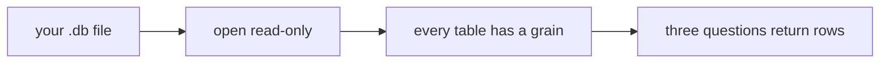

# Point at your database

## The problem

The course data is not your data. A learner who only ever sees the Olist world cannot tell if the desk works on
their own tables. For example, a bakery owner has one SQLite file with a `sales` table. Does the desk even read it? Before you trust any agent on your data, prove it can open your file and read what
each table means.

## Your challenge

Use a SQLite file of your own. No file? Copy a small one, or build one from a spreadsheet.

1. Open `my-database.toml` in this folder. Set `path` to your file. It must not be the course database.
2. Add a `[[table]]` block for every table in your file. Write its grain: what one row stands for.
3. Add three `[[question]]` blocks. Each has a real question you ask, and one `SELECT` that answers it.

Run the check on your file:

```bash
bun run verify point-at-your-database
```

Expect: `Done. All 4 rules pass.` when your file and notes are right. The check opens your file read-only. It never
touches the course data.



## Done when

- `path` names a SQLite file that exists and is not the course database.
- The file opens read-only and holds a table with rows.
- Every table has a block with a grain of at least three words.
- Three questions run as one `SELECT` on your file and return rows.

## If you get stuck

| What you see                    | Fix                                                                  |
| ------------------------------- | -------------------------------------------------------------------- |
| `FAIL path names a SQLite file` | The path is read from the folder that holds `my-database.toml`.      |
| `FAIL every table in the file`  | A table you forgot has no block. Add one for each.                   |
| `FAIL at least three questions` | One query returns no rows or has a `;` inside. Run it by hand first. |

## Words you will use

- **SQLite file**: a whole database kept in one file, often ending in `.db`.
- **Grain**: what one row of a table stands for.
- **Read-only**: opened so that nothing can change the data.
