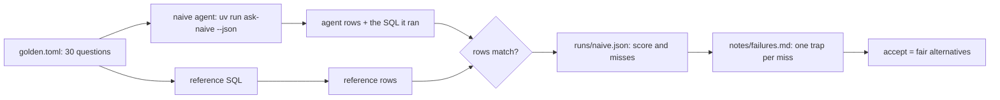

# Score the naive agent

## The problem

When a data agent is wrong in a way you can see, the mistake is cheap: someone notices it. When an agent gives a
wrong number that looks right, the mistake is expensive. The number goes into a plan, and nobody checks it.

For example, the naive agent says the total revenue is 15,843,553.24. That looks fine. But the reference answer,
the sum of all payments, is 16,008,872.12. Nothing on the screen tells you that the two are different.

Two words help you read the research below. Text-to-SQL means the model writes SQL straight from the question. A
semantic layer means the model picks from fixed metric definitions instead.

Other teams found the same problem:

- dbt Labs asked the same 11 questions 20 times each, on one of its own data projects
  ([dbt Labs, 2026 benchmark](https://docs.getdbt.com/blog/semantic-layer-vs-text-to-sql-2026)).
  This is a company testing its own product, so read it with care.
- In that test, text-to-SQL gave wrong answers that looked right. The semantic layer gave a clear error instead.
- With one model, text-to-SQL scored 90.0% and the semantic layer scored 98.2%.
- LinkedIn found that 60% of the questions in its text-to-SQL test had more than one accepted answer
  ([LinkedIn Engineering](https://www.linkedin.com/blog/engineering/ai/practical-text-to-sql-for-data-analytics)).
- If you ignore this, the score shows 10 to 15% fewer right answers than the agent really gives.

So before you fix anything, you measure. In this part you do three things:

1. You give the naive agent a score on 30 golden questions.
2. You name the cause of every miss.
3. You make the golden set fair where a business number has two honest definitions.



## Steps

| Step                                                                | Minutes | You produce                                                      | The check reads                                                                   |
| ------------------------------------------------------------------- | ------- | ---------------------------------------------------------------- | --------------------------------------------------------------------------------- |
| [score-the-naive-agent](01-score-the-naive-agent/problem/README.md) | 10      | `runs/naive.json`: 30 answers, each judged by rows               | the run file; it re-runs every query the agent ran and judges every answer itself |
| [read-the-failures](02-read-the-failures/problem/README.md)         | 10      | `notes/failures.md`: one line per miss with its trap             | your lines, the run, and the traps in `world/golden.toml`                         |
| [accept-many-answers](03-accept-many-answers/problem/README.md)     | 15      | `golden.toml` where revenue and GMV accept both fair definitions | every accepted query, run on the database, against the fair definitions           |

## Walkthrough

Run these commands in order. Each one prints the line under it when your work is right.

```bash
bun run score naive --for score-the-naive-agent
```

Expect: `Score: 14 of 30 match.` and `Wrote parts/01-score-the-naive-agent/01-score-the-naive-agent/problem/runs/naive.json`.

```bash
bun run verify score-the-naive-agent
```

Expect: `Done. All 6 rules pass.`

```bash
bun run verify read-the-failures
```

Expect: `Done. All 6 rules pass.` once `notes/failures.md` names a trap for each of the 16 misses.

```bash
bun run score naive --for accept-many-answers
```

Expect: `Score: 16 of 30 match.` once both questions accept their second definition.

```bash
bun run verify part score-the-naive-agent
```

Expect: `Part score-the-naive-agent is done: 3/3 steps pass.`

## Read before or after

- Jin and others, [Pervasive Annotation Errors Break Text-to-SQL Benchmarks and Leaderboards](https://arxiv.org/abs/2601.08778). It shows why you check every golden answer by hand.
- [defog-ai/sql-eval](https://github.com/defog-ai/sql-eval). It uses the same idea: compare the result rows, not the SQL text.
