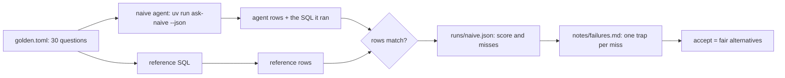

# Score the naive agent

## The problem

A data agent that is wrong in a way you can see is cheap: someone notices. One that returns a plausible wrong
number is expensive, because the number goes into a plan. dbt Labs ran the same 11 questions 20 times against a
modeled project and found that text-to-SQL fails with a plausible wrong answer while a semantic layer fails with
an error; with one model, text-to-SQL scored 90.0% and the semantic layer 98.2%
([dbt Labs, 2026 benchmark](https://docs.getdbt.com/blog/semantic-layer-vs-text-to-sql-2026), a vendor's benchmark on its own modeled project).
LinkedIn found that 60% of the questions in its text-to-SQL benchmark had more than one accepted answer, and that
ignoring this under-reports recall by 10 to 15%
([LinkedIn Engineering](https://www.linkedin.com/blog/engineering/ai/practical-text-to-sql-for-data-analytics)).

Before you fix anything, you measure. This part gives the naive agent a score on 30 golden questions, names the
cause of every miss, and makes the golden set fair where a business number has two honest definitions.



## Steps

| Step | Minutes | You produce | The check reads |
|---|---|---|---|
| [score-the-naive-agent](01-score-the-naive-agent/problem/README.md) | 10 | `runs/naive.json`: 30 answers, each judged by rows | the run file; it re-runs every query the agent ran and judges every answer itself |
| [read-the-failures](02-read-the-failures/problem/README.md) | 10 | `notes/failures.md`: one line per miss with its trap | your lines, the run, and the traps in `world/golden.toml` |
| [accept-many-answers](03-accept-many-answers/problem/README.md) | 15 | `golden.toml` where revenue and GMV accept both fair definitions | every accepted query, run on the database, against the fair definitions |

## Walkthrough

```bash
bun run score naive --for score-the-naive-agent
```

Expect: `Score: 14 of 30 match.` and `Wrote parts/01-score-the-naive-agent/01-score-the-naive-agent/problem/runs/naive.json`.

```bash
bun run verify score-the-naive-agent
```

Expect: `Done. All 6 rules pass.`

```bash
bun run verify read-the-failures
```

Expect: `Done. All 6 rules pass.` once `notes/failures.md` names a trap for each of the 16 misses.

```bash
bun run score naive --for accept-many-answers
```

Expect: `Score: 16 of 30 match.` once both questions accept their second definition.

```bash
bun run verify part score-the-naive-agent
```

Expect: `Part score-the-naive-agent is done: 3/3 steps pass.`

## Read before or after

- Jin and others, [Pervasive Annotation Errors Break Text-to-SQL Benchmarks and Leaderboards](https://arxiv.org/abs/2601.08778): why you hand-check every golden answer.
- [defog-ai/sql-eval](https://github.com/defog-ai/sql-eval): the same idea, compare result rows, not SQL text.
