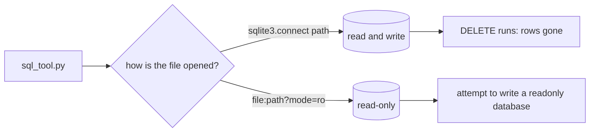

# Open read-only

## The problem

The naive agent opens the database like this: `sqlite3.connect(DB_PATH)`. That connection can read, and it can
also change and delete. So if the model ever writes a `DELETE`, the rows are gone.

For example, send `DELETE FROM orders` to a tool that opens the file this way. SQLite runs it. All 99,441 orders
disappear, and nothing warns you.

You can stop this in the database itself. SQLite can open a file in read-only mode. Then SQLite refuses every
write, whatever the SQL says.



## Your challenge

This folder holds `sql_tool.py`. It is the only door from the agent to the database. Change `connect()` so it
opens the file read-only.

Try the tool by hand first. A read works:

```bash
uv run python parts/02-lock-the-database/01-open-read-only/problem/sql_tool.py "SELECT COUNT(*) FROM sellers"
```

Expect: `{"columns": ["COUNT(*)"], "rows": [[3095]]}`

Do not send a write to your real database by hand. The check sends writes for you, to a small copy.

## Done when

- A `SELECT` still returns its rows.
- `DELETE FROM orders` comes back with an error that says the database is read-only.
- `UPDATE`, `INSERT`, `DROP` and `CREATE` get the same error.
- After all those writes, every table in the copy keeps its row count.
- Your real `data/olist.db` still has every row.

```bash
bun run verify open-read-only
```

Expect: `Done. All 5 rules pass.`

## If you get stuck

| What you see                                                    | Fix                                                                          |
| --------------------------------------------------------------- | ---------------------------------------------------------------------------- |
| `FAIL ... DELETE FROM orders comes back with a read-only error` | Use `sqlite3.connect(f"file:{path}?mode=ro", uri=True)`.                     |
| `FAIL ... every kind of write gets a read-only error`           | Do not look for words like `DELETE` in the SQL. Open the file read-only.     |
| `FAIL sql_tool.py answers a SELECT`                             | Keep `uri=True`. On some computers SQLite makes a new empty file without it. |
| `FAIL your real data/olist.db still has every row`              | Run `bun run world reset`. Keep `database_path()` as it is.                  |

## Words you will use

- **Read-only mode**: SQLite opens the file so that it can only read. Every write fails with an error.
- **URI**: a file name written like a web address, `file:data/olist.db?mode=ro`. The part after `?` holds options.
- **Row count**: how many rows a table has. The check compares counts before and after each write.
