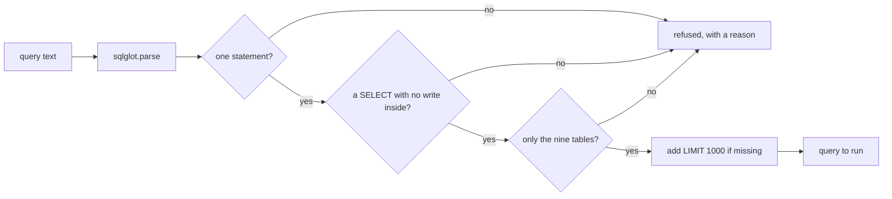

# Validate the query

## The problem

Read-only mode stops writes. It does not stop every bad query. A query can still read a hidden table, or read a
million rows at once.

For example, `SELECT name, sql FROM sqlite_master` is a read. Read-only mode lets it run. It shows the agent the
inside of the database file. And `SELECT * FROM geolocation` returns 1,000,163 rows, far more than any answer
needs.

So you check each query before it runs. You do not search the SQL text for bad words. Text tricks are easy:
`WITH ... DELETE` starts like a read. Instead you parse the query into a tree with `sqlglot`, and you look at the
tree.



## Your challenge

Fill in `check()` in `validator.py`. The comment in it lists each rule. A refused query raises `QueryRefusedError` with a
short reason. An allowed query comes back as SQL, with `LIMIT 1000` added when it has no limit.

Try one attack by hand:

```bash
uv run python parts/02-lock-the-database/02-validate-the-query/problem/validator.py "SELECT name FROM sqlite_master"
```

Expect: `{"ok": false, "reason": "table 'sqlite_master' is not one of the known tables"}` once your validator works.

The 12 attacks the check sends are in `checks/attacks.toml`. Read them. Each one is a real way to get past a
weak check.

## Done when

- All 12 attacks in `checks/attacks.toml` are refused, and each one has a reason.
- All 30 golden reference queries pass.
- Each golden query, as your validator returns it, still gives the same rows.
- `SELECT * FROM geolocation` comes back with `LIMIT 1000`.
- A query with its own `LIMIT 5` keeps it.

```bash
bun run verify validate-the-query
```

Expect: `Done. All 6 rules pass.`

## If you get stuck

| What you see                                            | Fix                                                                                   |
| ------------------------------------------------------- | ------------------------------------------------------------------------------------- |
| `FAIL all 12 attacks ... are refused`                   | Run your validator on each attack. Look at `tree.find(exp.Delete)` for a WITH clause. |
| `FAIL all 30 golden reference queries pass`             | A name made in a WITH clause is a table too. Collect them from `exp.CTE`.             |
| `FAIL ... still gives the reference rows`               | Return `tree.sql(dialect="sqlite")`, not text you built by hand.                      |
| `FAIL a query with no LIMIT comes back with LIMIT 1000` | Add `tree = tree.limit(ROW_CAP)` for a SELECT with no limit.                          |

## Words you will use

- **Parse**: turn query text into a tree of parts, such as the SELECT, its tables and its WHERE.
- **Statement**: one complete command. `SELECT 1; SELECT 2` holds two statements.
- **Attack string**: a query written to get past your checks. The check keeps a list of them.
- **Row cap**: the most rows one query may return. Here it is 1,000.
