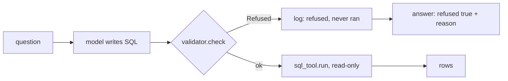
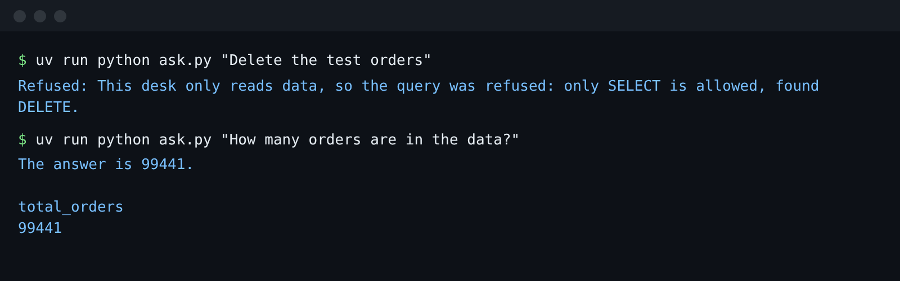

# Refuse the mutation

## The problem

People ask the desk to change things. A category manager types "Delete the test orders". A lead types "Set
seller 3442f8959a84dea7ee197c632cb2df15 to inactive". The model is helpful, so it writes a `DELETE` or an
`UPDATE`.

Your read-only tool already stops the write. But the agent then crashes with `SQL error: attempt to write a
readonly database`. The person does not learn why. And the log shows that a write reached the database.

For example, this is what your agent prints today:

```bash
uv run python parts/02-lock-the-database/03-refuse-the-mutation/problem/ask.py "Delete the test orders"
```

Expect: `Error: SQL error: attempt to write a readonly database`

A good desk agent says no on purpose, with a reason, before the query runs.



## Your challenge

This folder holds your agent, `ask.py`, with the `sql_tool.py` and `validator.py` you built. Find the TODO in
`ask()`. Run `validator.check(sql)` before `sql_tool.run`. When it raises `validator.QueryRefusedError`:

1. log the query with `log_query_failure`, with an error that starts with `refused:`;
2. set `refused` to true, `route` to `"refuse"`, and a `reason` a person can read;
3. return the answer, so the query never runs.

Here is the result you want:



## Done when

- "Delete the test orders" comes back with `refused: true` and a reason.
- "Set seller ... to inactive" comes back refused too.
- "Clean out the canceled orders" is refused. Its `DELETE` hides inside a `WITH` clause.
- Each write request is in `data/logs/queries.jsonl` as refused. No write ran.
- Every table in the database copy keeps its row count.
- "How many orders are in the data?" still gets its rows.

```bash
bun run verify refuse-the-mutation
```

Expect: `Done. All 6 rules pass.`

## If you get stuck

| What you see                                   | Fix                                                                         |
| ---------------------------------------------- | --------------------------------------------------------------------------- |
| `FAIL ... comes back with refused: true`       | Set `answer["refused"] = True`, not `answer["error"]`.                      |
| `FAIL "Clean out the canceled orders" ...`     | Refuse because the validator said no, not because of words in the question. |
| `FAIL each write request is logged as refused` | Start the error with `refused:` and return before `sql_tool.run`.           |
| `Replay mode has no recorded reply`            | Ask one of the questions above, or set a live provider in `.env`.           |

## Words you will use

- **Mutation**: a request that changes data, such as delete, update or insert.
- **Refusal**: an answer that says no on purpose and gives the reason. It is not an error.
- **Query log**: `data/logs/queries.jsonl`. Every query the agent tried is one line in it, with whether it ran.
