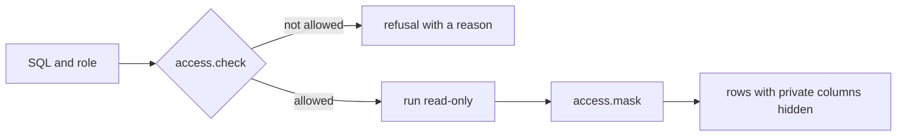

# Mask the private columns

## The problem

A seller partner asks the desk a question. The desk can read the `customers` table, so it may answer with a
buyer's id and zip code. The partner was never meant to see those.

For example, "which cities do our buyers live in?" comes back with a zip prefix for every buyer. One question, one
leak. A good desk checks who is asking, and hides private columns before the rows leave.

## Your challenge

This folder holds `access.py`. It has two TODOs: `check` and `mask`.

1. In `check(role, sql)`, use `sqlglot` to list every table the query reads, even inside a join or a `WITH`
   clause. Raise `AccessDeniedError` when the role may not read one. Raise for a role that is not listed.
2. In `mask(role, columns, rows)`, swap each value in `PRIVATE_COLUMNS` for a short hash, so one person keeps one
   token. Hide the zip prefix. Admin sees the rows as they are.

Try your check on a partner:

```bash
uv run python parts/02-lock-the-database/04-mask-the-private-columns/problem/access.py check partner "SELECT * FROM customers"
```

Expect: this line once `check` is done.

```text
{"ok": false, "reason": "the role 'partner' may not read the table 'customers'"}
```



## Done when

- Admin may read the customers table.
- Partner may read sellers but not customers, and the refusal has a reason.
- Partner is also refused when customers hides in a join or a `WITH` clause.
- A role that is not listed may read nothing.
- Analyst sees one token per person, and the zip prefix is hidden.
- Admin sees the rows as they are.

```bash
bun run verify mask-the-private-columns
```

Expect: `Done. All 7 rules pass.`

## If you get stuck

| What you see                              | Fix                                                                      |
| ----------------------------------------- | ------------------------------------------------------------------------ |
| `FAIL ... hides in a join`                | Loop over `find_all(exp.Table)`. Do not stop at the first table.         |
| `FAIL ... a role that is not in the list` | Use `TABLES_BY_ROLE.get(role)`. When it is `None`, raise.                |
| `FAIL ... same token for the same person` | Hash the value. A fixed word such as `***` gives every person one token. |

## Words you will use

- **Role**: who is asking, such as admin, analyst or partner.
- **Masking**: hiding a private value but keeping the row, so counts still work.
- **Hash**: a short code made from a value. The same value always gives the same code.
