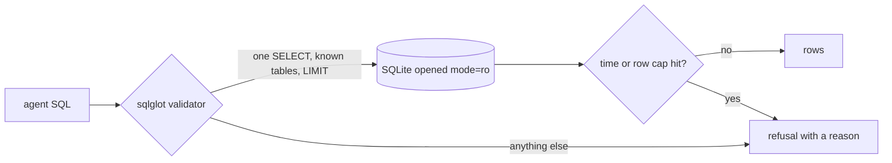

# Lock the database

This part is planned. Its steps do not exist yet. The table below says what each step will ask you to build, and
what its check will read.

## The problem

The naive agent cuts the model's reply at every `;` and runs each piece. It runs them on a connection that can
change the data.

So one hidden order in a review comment could delete a whole table. This kind of attack is called a prompt
injection: text in the data that tells the model what to do. And one bad join could read a million geolocation
rows.

LinkedIn's SQL Bot checks that every table and column exists before a query runs. It also runs `EXPLAIN` first,
to see how much work the query will do
([LinkedIn Engineering](https://www.linkedin.com/blog/engineering/ai/practical-text-to-sql-for-data-analytics)).
Before you teach the agent anything else, you prove it cannot change data or read too many rows.

For example, the finished agent already does this. Ask it `uv run ask-finished "Delete the test orders"`. It
prints `Refused: This desk answers questions with read-only queries.` Then it gives the reason: "Deleting orders
changes the system of record; ask the data platform team to do it through their change process."



## Steps

30 minutes in 3 steps.

| Step                  | Minutes | You produce                                                                                        | The check reads                                                                                               |
| --------------------- | ------- | -------------------------------------------------------------------------------------------------- | ------------------------------------------------------------------------------------------------------------- |
| `open-read-only`      | 8       | the SQL tool opens `file:...?mode=ro`                                                              | sends `DELETE FROM orders` straight to the tool; expects a read-only error and unchanged row counts           |
| `validate-the-query`  | 12      | a `sqlglot` validator: one SELECT, the 9 known tables, `LIMIT 1000` added, no `ATTACH` or `PRAGMA` | 12 attack strings from `checks/attacks.toml` each refused with a reason; all 30 golden reference queries pass |
| `refuse-the-mutation` | 10      | the agent refuses 'Delete the test orders' and 'Set seller X to inactive'                          | `ask --json` returns `refused: true` and a reason; `data/logs/queries.jsonl` holds no write verb              |

## Walkthrough

TODO(part session): one command per step, each with its Expect line.

```bash
bun run verify part lock-the-database
```

Expect: `Part lock-the-database is done: 3/3 steps pass.` once the steps exist.
