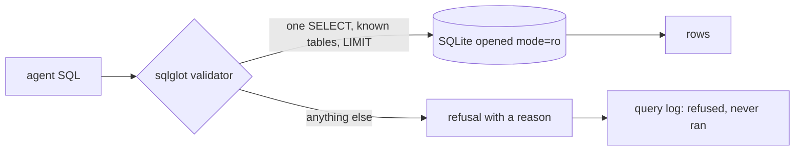

# Lock the database

## The problem

The naive agent cuts the model's reply at every `;` and runs each piece. It runs them on a connection that can
change the data.

So one hidden order in a review comment could delete a whole table. This kind of attack is called a prompt
injection: text in the data that tells the model what to do. And one careless query could read all 1,000,163
geolocation rows at once.

For example, the naive agent opens the file with `sqlite3.connect(DB_PATH)`. If the model replies
`DELETE FROM orders`, all 99,441 orders are gone. No error, no warning.

Before you teach the agent anything else, you prove three things:

1. The database itself refuses every write.
2. Every query is checked before it runs: one `SELECT`, only the nine tables, at most 1,000 rows.
3. When someone asks the agent to change data, it says no, with a reason.

The finished agent already does this. Ask it `uv run ask-finished "Delete the test orders"`. It prints
`Refused: This desk answers questions with read-only queries.` and a reason.



## Steps

30 minutes in 3 steps.

| Step                                                            | Minutes | You produce                                                                | The check reads                                                                                          |
| --------------------------------------------------------------- | ------- | -------------------------------------------------------------------------- | -------------------------------------------------------------------------------------------------------- |
| [open-read-only](01-open-read-only/problem/README.md)           | 8       | `sql_tool.py` opens `file:...?mode=ro`                                     | sends five kinds of write straight to the tool; expects read-only errors and unchanged row counts        |
| [validate-the-query](02-validate-the-query/problem/README.md)   | 12      | `validator.py` on `sqlglot`: one SELECT, the 9 tables, `LIMIT 1000` added  | the 12 attacks in `checks/attacks.toml` each refused with a reason; all 30 golden reference queries pass |
| [refuse-the-mutation](03-refuse-the-mutation/problem/README.md) | 10      | `ask.py` refuses "Delete the test orders" and "Set seller ... to inactive" | `ask.py --json` returns `refused: true` and a reason; `data/logs/queries.jsonl` shows no write ran       |

Each step folder holds its own files. A step starts from the work of the step before it, already done.

## Walkthrough

Run these commands in order. Each one prints the line under it when your work is right.

Try the SQL tool with a read:

```bash
uv run python parts/02-lock-the-database/01-open-read-only/problem/sql_tool.py "SELECT COUNT(*) FROM sellers"
```

Expect: `{"columns": ["COUNT(*)"], "rows": [[3095]]}`

Open it read-only, then let the check send the writes to a copy:

```bash
bun run verify open-read-only
```

Expect: `Done. All 5 rules pass.`

Try your validator on one attack:

```bash
uv run python parts/02-lock-the-database/02-validate-the-query/problem/validator.py "DROP TABLE sellers"
```

Expect: `{"ok": false, "reason": "only SELECT is allowed, found DROP"}` once `check()` parses the query.

```bash
bun run verify validate-the-query
```

Expect: `Done. All 6 rules pass.`

Ask your agent to delete data:

```bash
uv run python parts/02-lock-the-database/03-refuse-the-mutation/problem/ask.py "Delete the test orders"
```

Expect: `Refused: This desk only reads data, so the query was refused: only SELECT is allowed, found DELETE.`

```bash
bun run verify refuse-the-mutation
```

Expect: `Done. All 6 rules pass.`

```bash
bun run verify part lock-the-database
```

Expect: `Part lock-the-database is done: 3/3 steps pass.`

## Assignment

**The problem.** One injected comment could drop a table.

**What you hand in.** A commit with your read-only `sql_tool.py`, your `sqlglot` validator and the refusal path
in `ask.py`.

**How it is graded.** Each line is yes or no.

| Question                                                                             | How it is checked                    |
| ------------------------------------------------------------------------------------ | ------------------------------------ |
| Does every write sent straight to the tool fail with a read-only error?              | `bun run verify open-read-only`      |
| Are 12 of 12 attacks refused, each with a reason, and do all 30 golden queries pass? | `bun run verify validate-the-query`  |
| Is every write request refused with a reason, with no write in the query log?        | `bun run verify refuse-the-mutation` |

**Extension, not graded.** Write 3 new attack strings that the course list misses. Add them to a copy of
`checks/attacks.toml` and show your validator refuses them.

## FINISHED

You now have an agent that cannot change the database. SQLite refuses writes, your validator refuses bad queries
before they run, and the agent says no with a reason. Every refusal is in the query log.

The answers are still often wrong. For example, "What is our total revenue?" has two fair answers, and the agent
picks one at random. In [define-the-metrics](../03-define-the-metrics/README.md) you write down what each business
number means, once, and the agent uses those definitions first.

## Read before or after

- [SQLite URI filenames](https://www.sqlite.org/uri.html). It explains `mode=ro` and the other options.
- [sqlglot](https://github.com/tobymao/sqlglot). The parser your validator uses.
