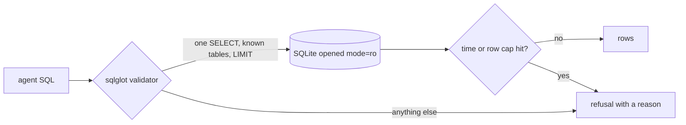

# Lock the database

This part is planned. Its steps are built by a later session; the table below is the contract for that work.

## The problem

The naive agent splits the model's reply on `;` and runs every statement on a read-write connection. One prompt
injection hidden in a review comment could drop a table, and one bad join could scan a million geolocation rows.
LinkedIn's SQL Bot checks that tables and fields exist and runs `EXPLAIN` before any query executes
([LinkedIn Engineering](https://www.linkedin.com/blog/engineering/ai/practical-text-to-sql-for-data-analytics)).
You prove the agent cannot change or scan the wrong rows before you teach it anything else.



## Steps

30 minutes in 3 steps.

| Step                  | Minutes | You produce                                                                                        | The check reads                                                                                               |
| --------------------- | ------- | -------------------------------------------------------------------------------------------------- | ------------------------------------------------------------------------------------------------------------- |
| `open-read-only`      | 8       | the SQL tool opens `file:...?mode=ro`                                                              | sends `DELETE FROM orders` straight to the tool; expects a read-only error and unchanged row counts           |
| `validate-the-query`  | 12      | a `sqlglot` validator: one SELECT, the 9 known tables, `LIMIT 1000` added, no `ATTACH` or `PRAGMA` | 12 attack strings from `checks/attacks.toml` each refused with a reason; all 30 golden reference queries pass |
| `refuse-the-mutation` | 10      | the agent refuses 'Delete the test orders' and 'Set seller X to inactive'                          | `ask --json` returns `refused: true` and a reason; `data/logs/queries.jsonl` holds no write verb              |

## Walkthrough

TODO(part session): one command per step, each with its Expect line.

```bash
bun run verify part lock-the-database
```

Expect: `Part lock-the-database is done: 3/3 steps pass.` once the steps exist.
