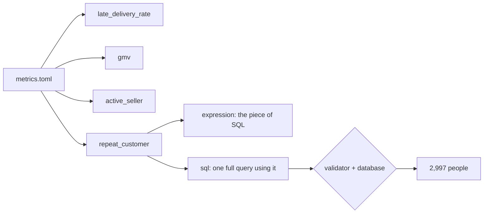

# Define the metrics

## The problem

A metric is a business number with one fixed meaning. The desk uses four of them every day. Today nobody has
written down what they mean, so the model guesses each time.

For example, ask "How many repeat customers did we have?" The model groups by `customer_id` and answers 0. But
`customer_id` is new on every order. The people are in `customer_unique_id`, and 2,997 of them ordered more than
once. Only one is right.

"Late" has the same problem. Compare the dates as text and 8.11% of delivered orders are late. Compare them as
dates and it is 6.77%.

So you write each metric down once, with an owner.



## Your challenge

Open `metrics.toml` in this folder. `gmv` is done, as an example. Add the other three metrics. Each one needs
five fields:

- `description`: what the number means, in one plain sentence;
- `owner`: the role who decides what it means, such as "logistics operations lead";
- `grain`: what one row counts, for example `order`, `seller` or `customer_unique_id`;
- `expression`: the piece of SQL that defines it, for example `COUNT(DISTINCT o.order_id) > 1`;
- `sql`: one full query that uses the expression on all the data.

What the three new metrics mean:

| Metric               | What it means                                                                 |
| -------------------- | ----------------------------------------------------------------------------- |
| `late_delivery_rate` | The share of delivered orders that came on a later day than the estimate.     |
| `active_seller`      | A seller with at least one item in an order placed in one year, such as 2018. |
| `repeat_customer`    | A person, `customer_unique_id`, with more than one order.                     |

For `active_seller`, the expression is the period test, so it goes after `WHERE`. For `repeat_customer`, it
tests a group, so it goes after `HAVING`.

Give each table a short name, called an alias: `o` for `orders`, `i` for `order_items` and `c` for
`customers`. The agent needs them next.

Run one query by hand:

```bash
uv run python -c "import sqlite3; print(sqlite3.connect('data/olist.db').execute('SELECT COUNT(*) FROM sellers').fetchall())"
```

Expect: `[(3095,)]`

## Done when

- `metrics.toml` defines `late_delivery_rate`, `gmv`, `active_seller` and `repeat_customer`.
- Each `sql` contains its own `expression`.
- Each `sql` passes the validator and returns rows.
- `repeat_customer` counts people by `customer_unique_id`: 2,997.
- `active_seller` has a period, such as 2018.
- `late_delivery_rate` compares dates: 6.77% of delivered orders.

```bash
bun run verify define-the-metrics
```

Expect: `Done. All 8 rules pass.`

## If you get stuck

| What you see                             | Fix                                                                   |
| ---------------------------------------- | --------------------------------------------------------------------- |
| `FAIL repeat_customer counts people`     | Join `customers c` and group by `c.customer_unique_id`.               |
| `FAIL active_seller has a period`        | Keep only orders placed in one year, then count the sellers left.     |
| `FAIL late_delivery_rate compares dates` | Wrap both columns in `date(...)`. Count delivered orders with a date. |
| `FAIL ... uses its own expression`       | Paste the expression into the sql exactly as it is.                   |
| A TOML error                             | Put `"""` around sql that spans lines.                                |

## Words you will use

- **Metric**: a business number with one written meaning, such as GMV.
- **Owner**: the person or role who decides what a metric means and answers questions about it.
- **Grain**: what one row stands for when you count. For repeat customers it is one person.
