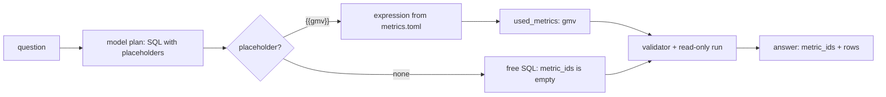

# Query through metrics

## The problem

A metric file helps only if the agent uses it. Today the model writes `{{gmv}}` in its SQL to say "use the GMV
metric here". Your agent does not fill it in, so the query fails.

There is a second problem. The model also tells you which metrics it used. It can be wrong.

For example, ask "What is our total revenue?" The model's plan says `"metric_ids": ["gmv"]`. But its SQL sums
`payment_value` by hand. No metric is in that query. An answer that says "this is GMV" would be a lie.

So the agent names a metric only when the metric's expression is really in the query it ran.



## Your challenge

This folder holds `ask.py` and your `metrics.toml`. Find the two TODOs in `ask.py`:

1. In `expand()`, replace a metric placeholder such as `{{gmv}}` with `metrics[name]["expression"]`. Add the
   name to `used_metrics` once. Refuse a name that is not in the file.
2. In `ask()`, put `used_metrics` into `answer["metric_ids"]`.

City placeholders such as `{{seller_city:Sao Paulo}}` are already filled in. You build your own value index in
the next part.

Try a metric question:

```bash
uv run python parts/03-define-the-metrics/02-query-through-metrics/problem/ask.py "What was GMV in 2018?"
```

Expect: `The answer is 8643697.6.` once `expand()` fills in `{{gmv}}`.

## Done when

The check asks all 30 golden questions, three times. In most runs:

- on the 10 metric questions, `metric_ids` names the right metric;
- on the metric questions, the rows match the reference;
- the 20 free SQL answers carry `metric_ids: []`;
- every question gets an answer with no error.

```bash
bun run verify query-through-metrics
```

Expect: `Done. All 4 rules pass.`

## If you get stuck

| What you see                                        | Fix                                                                    |
| --------------------------------------------------- | ---------------------------------------------------------------------- |
| `SQL error: no such column: gmv`                    | A `{{...}}` is still in the SQL. Return the expression from `replace`. |
| `FAIL the 20 free SQL answers carry metric_ids: []` | Do not copy `plan["metric_ids"]`. Use what `expand()` filled in.       |
| `FAIL ... the rows match the reference`             | Check `late_delivery_rate` in `metrics.toml` compares `date(...)`.     |

## Words you will use

- **Placeholder**: a name in braces, such as `{{gmv}}`, that the agent replaces before the query runs.
- **Free SQL**: a query the model wrote without a metric. It is allowed, but the answer must not claim a metric.
- **Metric first**: the agent's normal path is the metric file. Free SQL is the exception.
