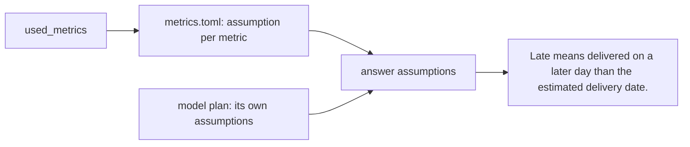

# State the assumptions

## The problem

An assumption is a choice the agent made that the question did not say. Every number has some. If the answer
hides them, the reader cannot tell if the number fits their need.

For example, ask "What percentage of delivered orders arrived late?" The agent answers 6.77. That is right, but
only for one meaning of "late": delivered on a later day than the estimated date. A logistics lead who counts
"late" from the promised hour expects 8.11. Without the assumption, the two people argue about the number instead
of the meaning.

So every answer lists its assumptions in plain English. A metric brings its own. The model adds the rest.



## Your challenge

Two changes, one in each file:

1. In `metrics.toml`, give each metric an `assumption`: one sentence a manager can read. The late one must say
   what late is measured against.
2. In `ask.py`, find the TODO. Set `answer["assumptions"]` to the assumption of each metric in `used_metrics`,
   then the model's `plan["assumptions"]`.

Try it:

```bash
uv run python parts/03-define-the-metrics/03-state-the-assumptions/problem/ask.py "What percentage of delivered orders arrived late?"
```

Expect: `Assumption: Late means delivered on a later day than the estimated delivery date.` and more, once both
changes are in.

## Done when

- Each metric in `metrics.toml` has an `assumption`.

The check asks all 30 golden questions, three times. In most runs:

- every answer lists at least one assumption;
- every answer that uses a metric shows that metric's assumption;
- every late-delivery answer says late is measured against the estimated date.

```bash
bun run verify state-the-assumptions
```

Expect: `Done. All 4 rules pass.`

## If you get stuck

| What you see                                             | Fix                                                                |
| -------------------------------------------------------- | ------------------------------------------------------------------ |
| `FAIL every golden answer lists at least one assumption` | Keep the model's assumptions too. Free SQL answers have no metric. |
| `FAIL every answer that uses a metric shows ...`         | Add `metrics[name]["assumption"]` for each name in `used_metrics`. |
| `FAIL late-delivery answers say ... the estimated date`  | Name the estimated delivery date in the late assumption.           |

## Words you will use

- **Assumption**: a choice the answer made that the question did not say, such as which orders count.
- **Plan**: the JSON the model replies with: its metrics, its SQL and its own assumptions.
