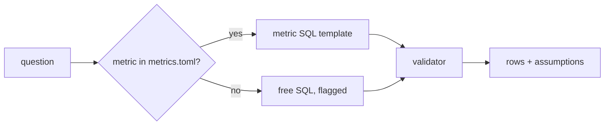

# Define the metrics

This part is planned. Its steps do not exist yet. The table below says what each step will ask you to build, and
what its check will read.

## The problem

A metric is a business number with one fixed meaning, such as revenue or the share of late orders. In this data,
"revenue" has two right answers: the payments (16,008,872.12) and the items plus freight (15,843,553.24). "Late"
also has two.

For example, order `8563039e855156e48fccee4d611a3196` arrived at `2018-03-20 00:59:25`. Its estimated delivery
date is `2018-03-20 00:00:00`. If you compare the two as text, the order is late. If you compare the dates, it
came on the estimated day, so it is on time. Across all delivered orders, that is 8.11% late against 6.77% late.

Anthropic wrote down skills and metric definitions for its own data questions. Without them, accuracy was 21% at
most. With them, it stayed above 95%
([Anthropic](https://claude.com/blog/how-anthropic-enables-self-service-data-analytics-with-claude)).

So the metric file becomes the agent's normal path. When the agent writes free SQL instead, that is the exception,
and the answer says so.



## Steps

35 minutes in 3 steps.

| Step                    | Minutes | You produce                                                                                                               | The check reads                                                                                          |
| ----------------------- | ------- | ------------------------------------------------------------------------------------------------------------------------- | -------------------------------------------------------------------------------------------------------- |
| `define-the-metrics`    | 15      | `metrics.toml`: `late_delivery_rate`, `gmv`, `active_seller`, `repeat_customer`, each with description, SQL, grain, owner | each metric's SQL passes the validator and returns rows; `repeat_customer` must use `customer_unique_id` |
| `query-through-metrics` | 12      | the agent uses a metric first and writes free SQL only when none fits                                                     | on the metric questions of the golden set, `metric_ids` names the right metric and the rows match        |
| `state-the-assumptions` | 8       | every answer lists its assumptions                                                                                        | `assumptions` is non-empty on every golden answer; late-delivery answers mention the estimated date      |

## Walkthrough

TODO(part session): one command per step, each with its Expect line.

```bash
bun run verify part define-the-metrics
```

Expect: `Part define-the-metrics is done: 3/3 steps pass.` once the steps exist.
