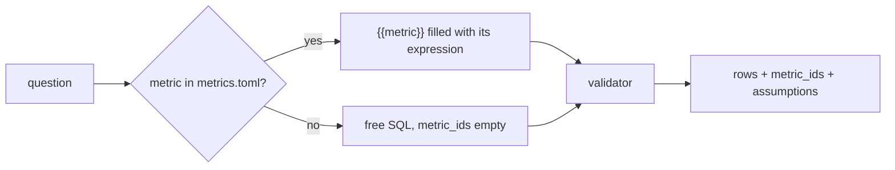

# Define the metrics

## The problem

A metric is a business number with one fixed meaning, such as revenue or the share of late orders. In this data,
"revenue" has two right answers: the payments (16,008,872.12) and the items plus freight (15,843,553.24). "Late"
also has two.

For example, order `8563039e855156e48fccee4d611a3196` arrived at `2018-03-20 00:59:25`. Its estimated delivery
date is `2018-03-20 00:00:00`. If you compare the two as text, the order is late. If you compare the dates, it
came on the estimated day, so it is on time. Across all delivered orders, that is 8.11% late against 6.77% late.

Anthropic wrote down skills and metric definitions for its own data questions. Without them, accuracy on its
tests was never above 21%. With them, it is "consistently above 95%"
([Anthropic](https://claude.com/blog/how-anthropic-enables-self-service-data-analytics-with-claude)).

So the metric file becomes the agent's normal path. When the agent writes free SQL instead, that is the exception,
and the answer says so. In this part you do three things:

1. You write the four desk metrics down once, each with an owner.
2. You make the agent use them first, and name the ones it used.
3. You make every answer list its assumptions.



## Steps

35 minutes in 3 steps.

| Step                                                                | Minutes | You produce                                                                           | The check reads                                                                                       |
| ------------------------------------------------------------------- | ------- | ------------------------------------------------------------------------------------- | ----------------------------------------------------------------------------------------------------- |
| [define-the-metrics](01-define-the-metrics/problem/README.md)       | 15      | `metrics.toml`: four metrics, each with description, owner, grain, expression and SQL | each metric's SQL passes the validator and returns rows; `repeat_customer` uses `customer_unique_id`  |
| [query-through-metrics](02-query-through-metrics/problem/README.md) | 12      | `ask.py` fills `{{metric}}` placeholders and names only the metrics it used           | on the 10 metric questions, `metric_ids` names the right metric and the rows match; free SQL has `[]` |
| [state-the-assumptions](03-state-the-assumptions/problem/README.md) | 8       | every answer lists its assumptions                                                    | `assumptions` is non-empty on every golden answer; late-delivery answers mention the estimated date   |

Each step folder holds its own files. A step starts from the work of the step before it, already done. The
recorded model plans for this part are in `replies.jsonl`, so everything runs with no key.

## Walkthrough

Run these commands in order. Each one prints the line under it when your work is right.

```bash
bun run verify define-the-metrics
```

Expect: `Done. All 7 rules pass.` once `metrics.toml` holds all four metrics.

```bash
uv run python parts/03-define-the-metrics/02-query-through-metrics/problem/ask.py "What was GMV in 2018?"
```

Expect: `The answer is 8643697.6.` once `expand()` fills in `{{gmv}}`.

```bash
bun run verify query-through-metrics
```

Expect: `Done. All 4 rules pass.`

```bash
uv run python parts/03-define-the-metrics/03-state-the-assumptions/problem/ask.py "How many orders placed in 2018 were delivered late?"
```

Expect: `Assumption: Late means delivered on a later day than the estimated delivery date.` once the answer lists
its assumptions.

```bash
bun run verify state-the-assumptions
```

Expect: `Done. All 4 rules pass.`

```bash
bun run verify part define-the-metrics
```

Expect: `Part define-the-metrics is done: 3/3 steps pass.`

## Assignment

**The problem.** "Revenue" has two right answers in this data.

**What you hand in.** A commit with `metrics.toml` (four metrics, each with an owner), metric-first routing in
`ask.py`, and assumptions on every answer.

**How it is graded.** Each line is yes or no.

| Question                                                                                | How it is checked                      |
| --------------------------------------------------------------------------------------- | -------------------------------------- |
| Does each metric have an owner, and does `repeat_customer` count `customer_unique_id`?  | `bun run verify define-the-metrics`    |
| Do the 10 metric questions name the right metric and match their rows?                  | `bun run verify query-through-metrics` |
| Does every golden answer list assumptions, and do late answers name the estimated date? | `bun run verify state-the-assumptions` |

**Extension, not graded.** Add a fifth metric with an owner other than yourself. Add a test that fails when its
grain is wrong.

## Finished

You now have one written meaning for each desk metric, an agent that uses those meanings first, and answers that
show their assumptions. A reader can see what each number means and who owns it.

The agent still guesses some facts about the data. It cannot know that `sao paulo` has nine spellings, or which of
the nine tables a question needs. In [retrieve-the-context](../04-retrieve-the-context/README.md) you give it table
cards, a value index, past questions and review search.

## Read before or after

- [How Anthropic enables self-service data analytics with Claude](https://claude.com/blog/how-anthropic-enables-self-service-data-analytics-with-claude).
  It shows why written definitions are the normal path, and how accuracy drifts without them.
