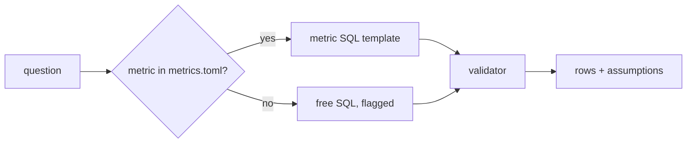

# Define the metrics

This part is planned. Its steps are built by a later session; the table below is the contract for that work.

## The problem

"Revenue" has two right answers in this data (payments 16,008,872.12, items plus freight 15,843,553.24), and
"late" has two. Anthropic reports its analytics accuracy did not exceed 21% without written skills and metric
definitions, and stayed above 95% with them
([Anthropic](https://claude.com/blog/how-anthropic-enables-self-service-data-analytics-with-claude)). The metric
file becomes the agent's default path; free SQL is the exception and says so.



## Steps

35 minutes in 3 steps.

| Step | Minutes | You produce | The check reads |
|---|---|---|---|
| `define-the-metrics` | 15 | `metrics.toml`: `late_delivery_rate`, `gmv`, `active_seller`, `repeat_customer`, each with description, SQL, grain, owner | each metric's SQL passes the validator and returns rows; `repeat_customer` must use `customer_unique_id` |
| `query-through-metrics` | 12 | the agent uses a metric first and writes free SQL only when none fits | on the metric questions of the golden set, `metric_ids` names the right metric and the rows match |
| `state-the-assumptions` | 8 | every answer lists its assumptions | `assumptions` is non-empty on every golden answer; late-delivery answers mention the estimated date |

## Walkthrough

TODO(part session): one command per step, each with its Expect line.

```bash
bun run verify part define-the-metrics
```

Expect: `Part define-the-metrics is done: 3/3 steps pass.` once the steps exist.
