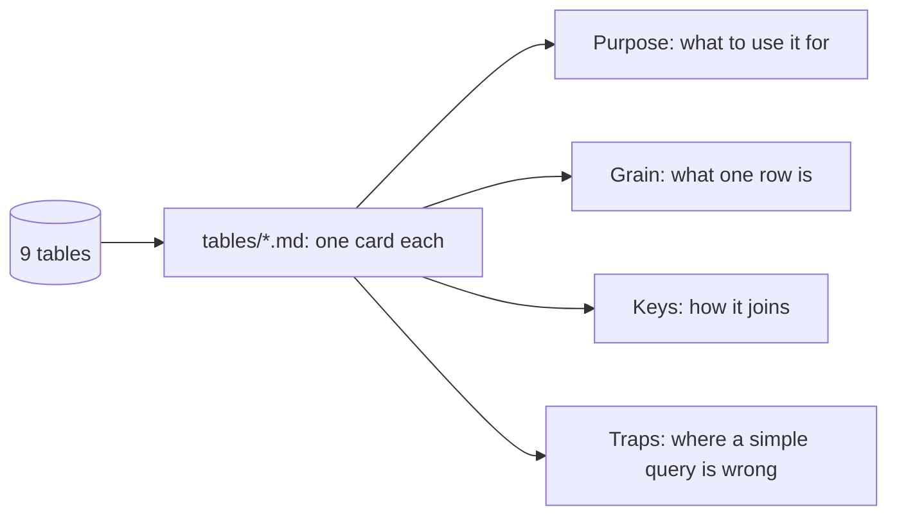

# Describe the tables

## The problem

The model sees only table and column names. Names do not say what a row is, or where the data lies to you.

For example, `customers` sounds like one row per person. It is one row per order: `customer_id` is new every time.
A model that trusts the name counts 0 repeat customers. And `geolocation` sounds small. It has 1,000,163 rows, so a
plain join repeats every order many times.

A table card fixes this. It is a short page per table that says what the table is for, what one row is, how it
joins, and its traps. People read it, and so does the agent.



## Your challenge

`tables/orders.md` is done, as an example. Write a card for each of the other 8 tables, with the same four
headings:

- `## Purpose`: what the table holds and which questions it answers, in plain words;
- `## Grain`: what one row is, for example "One row per seller (`seller_id`)";
- `## Keys`: the columns it joins on, each in backticks;
- `## Traps`: at least one bullet. Every table here has one.

The traps are measured for you in `world/README.md`. One table is not in that list: `order_reviews`. Find its
traps yourself. For example, count how many reviews have a comment:

```bash
uv run python -c "import sqlite3; print(sqlite3.connect('data/olist.db').execute('SELECT COUNT(review_comment_message), COUNT(*) FROM order_reviews').fetchall())"
```

Expect: `[(40977, 99224)]`. So fewer than half of the reviews have words you can search. Also look for orders with
more than one review.

List the columns of a table like this:

```bash
uv run python -c "import sqlite3; print([row[1] for row in sqlite3.connect('data/olist.db').execute('PRAGMA table_info(sellers)')])"
```

Expect: `['seller_id', 'seller_zip_code_prefix', 'seller_city', 'seller_state']`

Keep the sentences short. The repo's plain-English check reads your cards too.

## Done when

- `tables/` holds a card for each of the 9 tables.
- Each card has the sections Purpose, Grain, Keys and Traps.
- Each card says what one row is under Grain.
- Each card's Keys name a real column of its table.
- Each card lists at least one trap.

```bash
bun run verify describe-the-tables
```

Expect: `Done. All 5 rules pass.`

## If you get stuck

| What you see                               | Fix                                                                    |
| ------------------------------------------ | ---------------------------------------------------------------------- |
| `FAIL tables/ holds a card for each ...`   | Name each file after its table, such as `geolocation.md`.              |
| `FAIL each card's Keys name a real column` | Put the column in backticks and spell it as the table does.            |
| `FAIL each card lists at least one trap`   | "None found" is not a trap. Read the traps table in `world/README.md`. |

## Words you will use

- **Table card**: a short page about one table, for people and for the agent.
- **Grain**: what one row of the table stands for.
- **Key**: a column used to join one table to another, such as `order_id`.
- **Trap**: something in the table that makes a simple query give a wrong answer.
