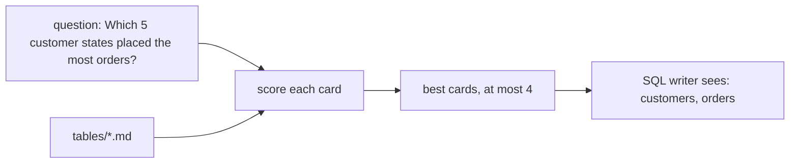

# Prune the schema

## The problem

You now have nine table cards. Sending all nine with every question is easy, and it is a mistake. The model
reads a long prompt, pays for it, and grabs a table it does not need.

For example, "Which 5 customer states placed the most orders?" needs only `customers` and `orders`. With all nine
cards in front of it, the model may join `geolocation` to find the states. That join repeats each order many
times, and the counts come out far too large.

So the agent picks the few cards a question needs, and sends only those to the SQL writer. To prune means to cut
away the parts you do not need.



## Your challenge

This folder holds `prune.py` and the nine cards in `tables/`. Today `select_tables()` returns every table. Make
it choose:

1. In `card_words()`, read the words of each card's Purpose section.
2. In `select_tables()`, score each table by the words its card shares with the question.
3. Keep the best tables that share any word, at most `MOST_TABLES` (4).

Any method passes, as long as the picks are right. You may also improve the cards: a word people ask with, such
as "late" or "stars", helps the right card win.

Try one question:

```bash
uv run python parts/04-retrieve-the-context/02-prune-the-schema/problem/prune.py "What is the average review score?"
```

Expect: `["order_reviews"]` once your scoring works. Today it prints all nine tables.

## Done when

- `prune.py --batch` prints a list of tables for every golden question.
- Every pick is a real table name.
- No question gets more than 4 tables.
- For at least 27 of the 30 golden questions, the picks hold every table the reference SQL reads.

```bash
bun run verify prune-the-schema
```

Expect: `Done. All 4 rules pass.`

## If you get stuck

| What you see                               | Fix                                                                      |
| ------------------------------------------ | ------------------------------------------------------------------------ |
| `FAIL no question gets more than 4 tables` | Return `matching[:MOST_TABLES]`, not every table.                        |
| `FAIL the picks cover ... for 27 of 30`    | Take the plural s off words, so "sellers" matches "seller".              |
| Every question picks `customers`           | Many cards say "order". Give a word in the table's own name more weight. |

## Words you will use

- **Schema**: the list of tables and their columns.
- **Prune**: cut away what a question does not need.
- **Score**: a number that says how well one card fits the question. Here it counts shared words.
