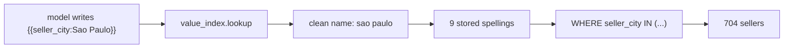
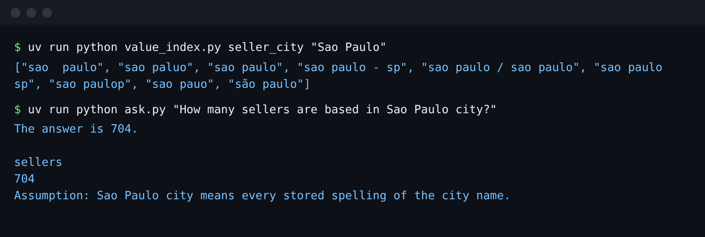

# Index the values

## The problem

The model types a city the way a person says it: `'sao paulo'`. The data stores it the way 704 sellers typed it,
in 9 spellings. One of them even hides its accent as a separate character.

For example, `WHERE seller_city = 'sao paulo'` finds 694 sellers. The right answer is 704. The other 10 are stored
as `sao paulop`, `sao pauo`, `sao paulo - sp`, `sao paulo / sao paulo` and more. No model can guess those.

A value index fixes this. It reads every stored value once and groups the spellings under one clean name. The
agent looks a name up and puts every spelling into the SQL.



## Your challenge

This folder holds `value_index.py`, and your agent with its metric file. Today `lookup()` finds only the exact
spelling. Make it find them all:

1. Group the stored values of each column in `COLUMNS` under a clean name. Use `fold()` for case and accents.
2. For a city, cut the name before `' / '` or `' - '`, and drop a trailing `' sp'`.
3. Treat a very close spelling as the same city. `difflib.get_close_matches` does this.
4. Look the text up by its clean name.

Be careful: `maua/sao paulo` is the city of Maua, not Sao Paulo.

```bash
uv run python parts/04-retrieve-the-context/03-index-the-values/problem/value_index.py seller_city "Sao Paulo"
```

Expect: a list of 9 spellings, from `"sao  paulo"` to `"são paulo"`, once your index works. Today it prints
`["sao paulo"]`.



## Done when

- A lookup of `seller_city` "Sao Paulo" returns all 9 stored spellings.
- It returns no other city, such as `maua/sao paulo`.
- The same 9 come back for "são paulo" and "SAO PAULO".
- `seller_state` "sp" finds `SP`, and `product_category_name` "BELEZA_SAUDE" finds `beleza_saude`.
- The agent's two Sao Paulo golden questions now match their reference rows.

```bash
bun run verify index-the-values
```

Expect: `Done. All 5 rules pass.`

## If you get stuck

| What you see                              | Fix                                                                  |
| ----------------------------------------- | -------------------------------------------------------------------- |
| `FAIL ... returns all 9 stored spellings` | Cut before the separator and drop `' sp'` before you compare.        |
| `FAIL it returns no other city`           | Match the clean name, not "contains". Keep only the part before `/`. |
| `FAIL the same 9 come back however ...`   | Fold the text you look up, the same way as the stored values.        |

## Words you will use

- **Value index**: a list of every stored value of a column, grouped by what it means.
- **Fold**: make text lower case and take the accents off, so `São` and `sao` compare equal.
- **Clean name**: the one name a group of spellings stands for, such as `sao paulo`.
