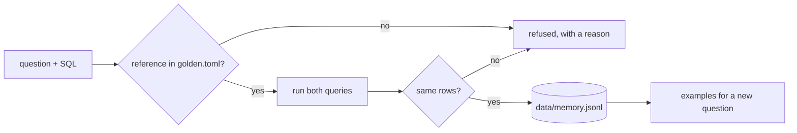

# Remember past questions

## The problem

The desk asks many of the same questions again and again. A past question with SQL that worked is a great
example to show the model. But a past pair with a wrong answer teaches the model the wrong answer, every time.

For example, an analyst once saved "How many sellers are based in Sao Paulo city?" with
`WHERE seller_city = 'sao paulo'`. It runs, and it says 694. The right answer is 704. If the store keeps that
pair, the agent copies the mistake forever.

So the store checks each pair before it keeps it. The rows must match the reference query for that question.



## Your challenge

Fill in `why_not_store()` in `memory.py`. Return a reason, so the pair is refused, when:

1. the question has no reference query in `world/golden.toml`;
2. the SQL does not run;
3. its rows are not the reference rows. Compare `comparable(rows)`, not the SQL text, and not the row count.

Return `None` when the pair is right. `add()` and `examples()` already work.

```bash
uv run python parts/04-retrieve-the-context/04-remember-past-questions/problem/memory.py add "How many sellers are based in Sao Paulo city?" "SELECT COUNT(*) FROM sellers WHERE seller_city = 'sao paulo'"
```

Expect: `{"stored": false, "reason": "its rows do not match the reference rows"}` once the store checks pairs.

## Done when

- A pair whose rows match the reference is stored, even when its SQL text is different.
- A pair whose rows do not match is refused on insert, with a reason.
- A pair whose SQL does not run is refused.
- A question with no reference in `world/golden.toml` is refused.
- Examples for a similar question return the stored pair first.

```bash
bun run verify remember-past-questions
```

Expect: `Done. All 5 rules pass.`

## If you get stuck

| What you see                                 | Fix                                                                    |
| -------------------------------------------- | ---------------------------------------------------------------------- |
| `FAIL a pair whose rows match ... is stored` | Two queries can be written differently and still be right.             |
| `FAIL a pair whose rows do not match ...`    | One row of 694 and one row of 704 have the same count. Compare values. |
| `FAIL a pair whose SQL does not run`         | Catch the error from `guard.run` and return it as the reason.          |

## Words you will use

- **Pair**: a question and the SQL that answered it.
- **Few-shot example**: a past pair shown to the model, so it writes SQL in the same way.
- **Verified**: checked against the reference rows before it is stored.
