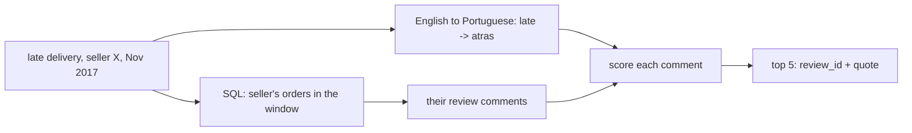

# Search the reviews

## The problem

Numbers say what happened. Reviews say why. A category manager sees late deliveries jump for one seller. The manager asks
"What do customers say about late delivery?" The answer is in 40,977 written comments, and they are in
Portuguese.

For example, seller `1f50f920176fa81dab994f9023523100` had many reviews on orders placed in November 2017. One says
"Atraso na entrega nunca é bom sinal", which means "A late delivery is never a good sign". A search for the English
word "late" finds nothing in it.

There is a second trap. A search over all reviews returns comments about other sellers and other months. The
answer then quotes the wrong evidence.

So the search runs SQL first, to keep only the seller's orders in the window. Then it looks for the Portuguese
words that mean what the English question asks.



## Your challenge

This folder holds `reviews.py`. Find the two TODOs:

1. Filter in SQL first. Keep only reviews of orders that hold an item of the seller, placed in the window.
2. In `roots_for()`, turn each English word into the Portuguese roots in `PORTUGUESE_ROOTS`.

A root is the start of a word. `atras` finds atraso, atrasado and atrasou.

```bash
uv run python parts/04-retrieve-the-context/05-search-the-reviews/problem/reviews.py "late delivery" --seller 1f50f920176fa81dab994f9023523100 --start 2017-11-01 --end 2017-12-01
```

Expect: the first quote is `Atraso na entrega nunca é bom sinal.` once both TODOs are done.

## Done when

The check asks 5 review questions, each for one seller and one window.

- Each question finds at least one review.
- Every returned `review_id` belongs to an order of the seller asked.
- Every returned order was placed in the window asked.
- Every quote is the comment stored for its `review_id`.
- An English question finds Portuguese comments about a late or missing delivery.

```bash
bun run verify search-the-reviews
```

Expect: `Done. All 5 rules pass.`

## If you get stuck

| What you see                                         | Fix                                                                   |
| ---------------------------------------------------- | --------------------------------------------------------------------- |
| `FAIL each of the 5 review questions finds ...`      | Look up each English word in `PORTUGUESE_ROOTS`.                      |
| `FAIL every returned review_id belongs ...`          | Add `r.order_id IN (SELECT i.order_id FROM order_items i WHERE ...)`. |
| `FAIL every returned order was placed in the window` | Add the start and end dates to the SQL, and pass them in order.       |

## Words you will use

- **Window**: a span of time, from a start date up to, but not including, an end date.
- **Root**: the start of a word that its other forms share, such as `atras`.
- **Evidence**: the review a claim rests on. Each one keeps its `review_id`, so anyone can check it.
