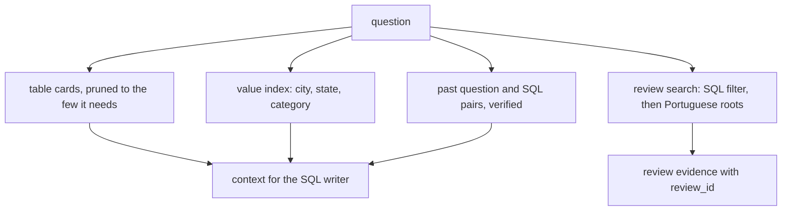

# Retrieve schema, values and reviews

## The problem

The model cannot guess some facts about this data:

- Nine different spellings in `seller_city` all mean one city. One of them uses a special accent character.
- `customers` has one row per order, not one per person.
- `product_name_lenght` is a real column name, even with the typo.

For example, the stored spellings of Sao Paulo include `sao paulo`, `sao paulop`, `sao pauo` and
`sao paulo / sao paulo`. A query that types only `'sao paulo'` finds 694 sellers, not 704.

Some answers are not in any column at all. The reason behind a jump in late deliveries is in 40,977 Portuguese
review comments.

Retrieval means finding the right context and handing it to the model at the moment it needs it. In this part you
build five kinds of it. The agent gets the table cards it needs and the real stored values. It also gets past questions that were
right, and the review comments that explain a number.



## Steps

45 minutes in 5 steps.

| Step                                                                    | Minutes | You produce                                                           | The check reads                                                                                                 |
| ----------------------------------------------------------------------- | ------- | --------------------------------------------------------------------- | --------------------------------------------------------------------------------------------------------------- |
| [describe-the-tables](01-describe-the-tables/problem/README.md)         | 8       | `tables/*.md`: one card per table with purpose, grain, keys and traps | 9 cards exist; each names its grain, a real key column and at least one trap                                    |
| [prune-the-schema](02-prune-the-schema/problem/README.md)               | 8       | `prune.py` picks at most 4 cards per question                         | the picks include every table of the reference SQL for at least 27 of 30 questions                              |
| [index-the-values](03-index-the-values/problem/README.md)               | 10      | `value_index.py` over cities, states and categories                   | a lookup of 'Sao Paulo' returns all 9 stored spellings and no other city; the Sao Paulo golden questions match  |
| [remember-past-questions](04-remember-past-questions/problem/README.md) | 7       | `memory.py`: a store of verified question and SQL pairs               | a pair whose rows do not match its reference is rejected on insert                                              |
| [search-the-reviews](05-search-the-reviews/problem/README.md)           | 12      | `reviews.py`: review search filtered by SQL first                     | every returned `review_id` belongs to the seller and window asked; an English query finds Portuguese complaints |

Each step folder holds its own files. A step starts from the work of the step before it, already done.

## Walkthrough

Run these commands in order. Each one prints the line under it when your work is right.

```bash
bun run verify describe-the-tables
```

Expect: `Done. All 5 rules pass.` once all nine cards are written.

```bash
uv run python parts/04-retrieve-the-context/02-prune-the-schema/problem/prune.py "What is the average review score?"
```

Expect: `["order_reviews"]` once `select_tables()` scores the cards.

```bash
bun run verify prune-the-schema
```

Expect: `Done. All 6 rules pass.`

```bash
uv run python parts/04-retrieve-the-context/03-index-the-values/problem/value_index.py seller_city "Sao Paulo"
```

Expect: a list of 9 spellings, from `"sao  paulo"` to `"são paulo"`.

```bash
bun run verify index-the-values
```

Expect: `Done. All 5 rules pass.`

```bash
bun run verify remember-past-questions
```

Expect: `Done. All 5 rules pass.`

```bash
uv run python parts/04-retrieve-the-context/05-search-the-reviews/problem/reviews.py "late delivery" --seller 1f50f920176fa81dab994f9023523100 --start 2017-11-01 --end 2017-12-01
```

Expect: the first quote is `Atraso na entrega nunca é bom sinal.`

```bash
bun run verify search-the-reviews
```

Expect: `Done. All 5 rules pass.`

```bash
bun run verify part retrieve-the-context
```

Expect: `Part retrieve-the-context is done: 5/5 steps pass.`

## Assignment

**The problem.** The model cannot guess nine spellings or read Portuguese reviews.

**What you hand in.** A commit with your table cards, schema pruning, value index, verified pair store and review
search.

**How it is graded.** Each line is yes or no.

| Question                                                                                   | How it is checked                        |
| ------------------------------------------------------------------------------------------ | ---------------------------------------- |
| Do all 9 cards name a grain, a real key and a trap?                                        | `bun run verify describe-the-tables`     |
| Do the picks cover the reference tables for at least 27 of 30 questions, 4 tables at most? | `bun run verify prune-the-schema`        |
| Does 'Sao Paulo' find all 9 spellings and no other city?                                   | `bun run verify index-the-values`        |
| Is a pair with wrong rows refused on insert?                                               | `bun run verify remember-past-questions` |
| Does every review found belong to the seller and window asked?                             | `bun run verify search-the-reviews`      |

**Extension, not graded.** Measure the golden score with and without the table cards. Record the difference in
your write-up.

## Finished

You now have every kind of context the agent needs:

- cards that describe each table, and a pruner that sends only the right ones;
- a value index that turns "Sao Paulo" into nine stored spellings;
- a store of past pairs that were right;
- a review search that quotes real comments with their `review_id`.

Each piece works on its own. In [build-the-loop](../05-build-the-loop/README.md) you join them in one agent loop:
it routes each question to SQL, reviews or both, repairs a failed query, and cites the rows behind every number.

## Read before or after

- [Python difflib](https://docs.python.org/3/library/difflib.html). The close-match function the value index uses.
- [SQLite full-text search](https://www.sqlite.org/fts5.html). A faster way to search many comments, which the
  finished agent uses.
