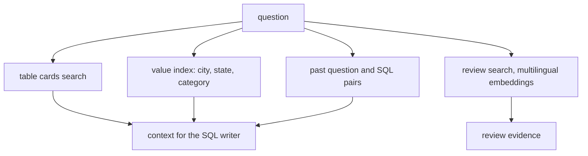

# Retrieve schema, values and reviews

This part is planned. Its steps do not exist yet. The table below says what each step will ask you to build, and
what its check will read.

## The problem

The model cannot guess some facts about this data:

- Nine different spellings in `seller_city` all mean one city. One of them uses a special accent character.
- `product_name_lenght` is a real column name, even with the typo.

For example, the stored spellings of Sao Paulo include `sao paulo`, `sao paulop`, `sao pauo` and
`sao paulo / sao paulo`. A query that types only `'sao paulo'` finds 694 sellers, not 704.

Uber's Finch keeps an index of column values and their other names. So the values in a `WHERE` match what is
really in the data ([Uber Engineering](https://www.uber.com/blog/unlocking-financial-insights-with-finch/)).

Some answers are not in any column at all. The reason behind a jump in late deliveries is in 40,977 Portuguese
review comments.



## Steps

45 minutes in 5 steps.

| Step                      | Minutes | You produce                                                           | The check reads                                                                                                             |
| ------------------------- | ------- | --------------------------------------------------------------------- | --------------------------------------------------------------------------------------------------------------------------- |
| `describe-the-tables`     | 8       | `tables/*.md`: one card per table with purpose, grain, keys and traps | 9 cards exist; each names its grain and at least one trap                                                                   |
| `prune-the-schema`        | 8       | the agent sends only the cards it needs to the SQL writer             | the selected tables include every table of the reference SQL for at least 27 of 30 questions                                |
| `index-the-values`        | 10      | a value index over cities, states and categories                      | a lookup of 'Sao Paulo' returns all 9 stored spellings; the Sao Paulo golden questions match                                |
| `remember-past-questions` | 7       | a store of verified question and SQL pairs used as examples           | a pair whose rows do not match its reference is rejected on insert                                                          |
| `search-the-reviews`      | 12      | review search with multilingual embeddings, filtered by SQL first     | every returned `review_id` belongs to the seller and window asked; an English query finds Portuguese late-delivery comments |

## Walkthrough

TODO(part session): one command per step, each with its Expect line.

```bash
bun run verify part retrieve-the-context
```

Expect: `Part retrieve-the-context is done: 5/5 steps pass.` once the steps exist.
