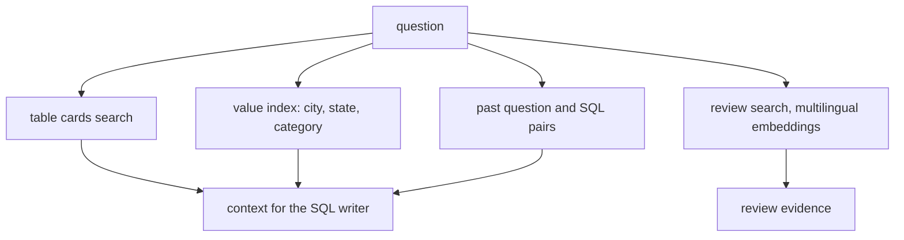

# Retrieve schema, values and reviews

This part is planned. Its steps are built by a later session; the table below is the contract for that work.

## The problem

The model cannot guess that nine spellings in `seller_city` mean one city (one of them uses a combining accent),
or that `product_name_lenght` is a real column. Uber's Finch keeps an index of column values and aliases so the
values in a `WHERE` match the data
([Uber Engineering](https://www.uber.com/blog/unlocking-financial-insights-with-finch/)). The reason behind a
late-delivery spike is in 40,977 Portuguese review comments, not in a column.



## Steps

45 minutes in 5 steps.

| Step | Minutes | You produce | The check reads |
|---|---|---|---|
| `describe-the-tables` | 8 | `tables/*.md`: one card per table with purpose, grain, keys and traps | 9 cards exist; each names its grain and at least one trap |
| `prune-the-schema` | 8 | the agent sends only the cards it needs to the SQL writer | the selected tables include every table of the reference SQL for at least 27 of 30 questions |
| `index-the-values` | 10 | a value index over cities, states and categories | a lookup of 'Sao Paulo' returns all 9 stored spellings; the Sao Paulo golden questions match |
| `remember-past-questions` | 7 | a store of verified question and SQL pairs used as examples | a pair whose rows do not match its reference is rejected on insert |
| `search-the-reviews` | 12 | review search with multilingual embeddings, filtered by SQL first | every returned `review_id` belongs to the seller and window asked; an English query finds Portuguese late-delivery comments |

## Walkthrough

TODO(part session): one command per step, each with its Expect line.

```bash
bun run verify part retrieve-the-context
```

Expect: `Part retrieve-the-context is done: 5/5 steps pass.` once the steps exist.
