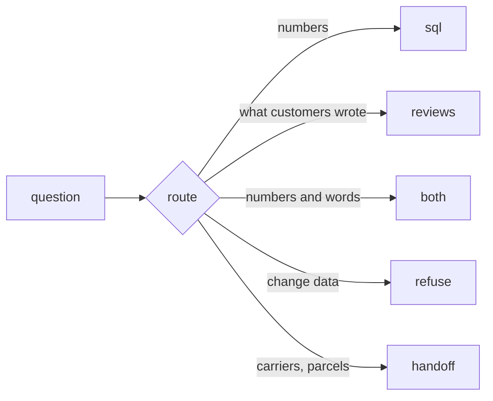

# Route the question

## The problem

Your agent sends every question to SQL. That works for "How many orders were delivered?". It fails for "What do
customers say about late deliveries?". SQL can count reviews, but it cannot read them.

It is worse for a write. "Delete the test orders" should never reach the SQL tool at all.

A router fixes this. It reads the question first and picks the path.



## Your challenge

Open `router.py` in this folder. Change `route(question)` so it returns one of five routes:

| Route     | When                                       | For example                                                                     |
| --------- | ------------------------------------------ | ------------------------------------------------------------------------------- |
| `sql`     | the question needs numbers                 | "How many orders were delivered?"                                               |
| `reviews` | the question asks what customers wrote     | "What do one-star reviews complain about in cama_mesa_banho?"                   |
| `both`    | the question needs numbers and words       | "How many one-star reviews did beleza_saude get in 2018, and what do they say?" |
| `refuse`  | the question asks the desk to change data  | "Set seller 3442f8 to inactive"                                                 |
| `handoff` | the question belongs to the logistics team | "Which carrier delivered order 0005a1a1?"                                       |

Rules on words are enough here. For example, a question whose first word is "delete" or "set" is a write.

Try your router on a few questions:

```bash
uv run python parts/05-build-the-loop/kit.py route-the-question "Delete the test orders" "Why are customers unhappy with seller 955fee92?"
```

Expect: `{"question": "Delete the test orders", "route": "refuse"}` and a second line with `"route": "reviews"`.

The 10 questions with other routes are in `parts/05-build-the-loop/kit.toml`. The 30 golden questions all need
`sql`.

## Done when

- `router.py` prints one known route for each of the 40 questions.
- At least 36 of the 40 routes match the expected route.
- Every request to change data is refused.
- Every question about carriers and parcels is handed off.

```bash
bun run verify route-the-question
```

Expect: `Done. All 4 rules pass.`

## If you get stuck

| What you see                                   | Fix                                                                                       |
| ---------------------------------------------- | ----------------------------------------------------------------------------------------- |
| `FAIL ... prints one known route`              | Return one of the five words exactly, in lower case.                                      |
| `FAIL at least 36 of the 40 routes match`      | Run the 10 questions from `kit.toml` and fix the kind you get wrong.                      |
| `FAIL every request to change data is refused` | Check the first word of the question before any other rule.                               |
| A golden question now says `reviews`           | "How many reviews have a written comment?" needs numbers. Avoid "review" alone as a sign. |

## Words you will use

- **Router**: the first part of the agent. It reads the question and picks the path.
- **Hand-off**: passing a question to another team's agent, because that team owns the data.
