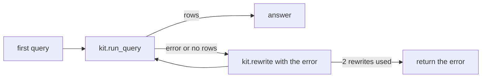

# Correct the error

## The problem

A model often writes a query with a small mistake: a column name that does not exist, or a filter with the wrong
spelling. Your agent stops at the first error. The user gets an error message instead of an answer.

Fixing errors is not a rare case. For example, all 5 questions in this step start with a broken query. The
database error says exactly what is wrong, so a second try often works.

But retries cost time and money. A loop with no limit can run forever on a question it cannot fix.



## Your challenge

Open `retry.py` in this folder. Change `answer(question)` so it does this:

1. Run the query with `kit.run_query(question, sql)`.
2. If it raises `kit.SqlError`, or returns no rows, call `kit.rewrite(question, sql, error)`.
3. Run the new query. Stop after `MAX_RETRIES = 2` rewrites, and return the last error.

Pass the error to the rewrite. For an empty result, pass `kit.NO_ROWS`. A model cannot fix what it does not see.

For example, the first query for "How many orders were delivered?" is:

```sql
SELECT COUNT(*) AS orders FROM orders WHERE status = 'delivered'
```

The database says `no such column: status`. Given that error, the rewrite uses `order_status` instead.

```bash
uv run python parts/05-build-the-loop/kit.py correct-the-error "How many orders were delivered?"
```

Expect: a JSON line with `"rows": [[96478]]` and `"error": null`.

One of the 5 questions has three mistakes. With two retries it stays broken. That is the right result: the agent
gives up and says why.

## Done when

- `retry.py` prints one answer for each of the 5 questions.
- Every query goes through `kit.run_query`, so the ledger shows it. The ledger is `data/logs/loop.jsonl`.
- At least 4 of the 5 answers match the golden reference rows, in each of 3 runs.
- No question runs more than 3 queries: the first try and at most 2 retries.
- Every rewrite request carries the error it should fix.

```bash
bun run verify correct-the-error
```

Expect: `Done. All 5 rules pass.`

## If you get stuck

| What you see                                   | Fix                                                                    |
| ---------------------------------------------- | ---------------------------------------------------------------------- |
| `FAIL at least 4 of the 5 answers match`       | Catch `kit.SqlError`, and treat an empty `rows` list as a failure too. |
| `FAIL no question runs more than 3 queries`    | Count the rewrites and stop at `MAX_RETRIES`.                          |
| `FAIL every rewrite request carries the error` | Pass `str(error)` or `kit.NO_ROWS`, never an empty string.             |

## Words you will use

- **Retry**: running a new version of a query after the first one failed.
- **Ledger**: a log file of every query and every rewrite request. The check counts the lines in it.
