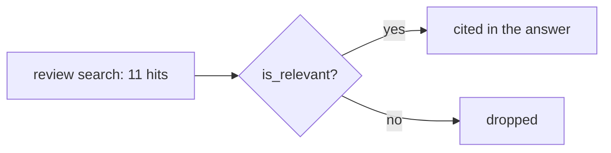

# Check the relevance

## The problem

Review search finds words, not meaning. A category manager asks about late deliveries. Search returns 11
reviews. Some are about late deliveries. Others only share a word with the question.

For example, review `34d1ec71` says "recebi o produto no prazo de entrega só que o bico de engate veio rachado".
That means "I got the product on time, but the part was cracked". It has the words "prazo de entrega" (delivery
deadline), so search found it. It is not about a late delivery. If the agent quotes it, the answer misleads.



## Your challenge

Open `relevance.py` in this folder. Change `is_relevant(question, review)` so it keeps only reviews about
deliveries that came late or never came.

Each review is a dictionary with `review_id`, `score` (1 to 5 stars) and `quote` (the customer's words, in
Portuguese). Here are some words to look for:

| Portuguese               | English                      |
| ------------------------ | ---------------------------- |
| atraso, atrasado         | delay, late                  |
| não recebi               | I did not receive            |
| demorou                  | it took a long time          |
| no prazo, antes do prazo | on time, before the deadline |

Be careful with two traps:

- A low score does not mean a late order. A broken product also gets one star.
- The word "entrega" (delivery) also appears in praise, like "entregue antes do prazo".

```bash
uv run python parts/05-build-the-loop/kit.py check-the-relevance
```

Expect: one JSON line whose `citations` list holds 6 reviews, not 11.

A rule on words works here. With a live model, you can also ask the `judge` role "Is this review about a late
delivery?". Then keep the rule as a fallback.

## Done when

- `relevance.py` prints one answer with a list of cited reviews.
- None of the 5 off-topic reviews is cited.
- At least 4 of the 6 late-delivery reviews are still cited.
- Every cited quote is the customer's own words from that review.

```bash
bun run verify check-the-relevance
```

Expect: `Done. All 4 rules pass.`

## If you get stuck

| What you see                                    | Fix                                                                      |
| ----------------------------------------------- | ------------------------------------------------------------------------ |
| `FAIL none of the 5 off-topic reviews is cited` | Print each kept quote and read it. Drop "no prazo" and product faults.   |
| `FAIL at least 4 of the 6 ... still cited`      | Your filter is too strict. Remove accents first, so "não" matches "nao". |

## Words you will use

- **Relevant**: about what the question asks. A review can match a word and still not be relevant.
- **Off-topic**: a search hit that is about something else.
