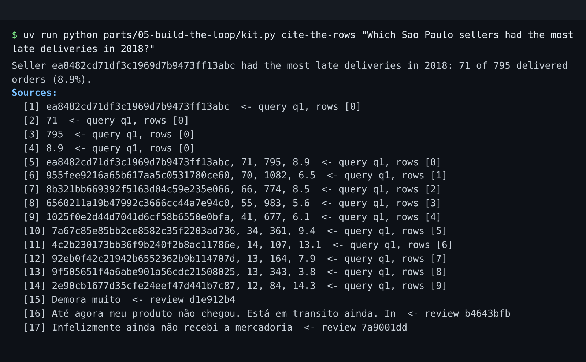

# Cite the rows

## The problem

An answer says "Seller ea8482cd had 71 late deliveries in 2018". The category manager wants to pause that
seller. First they ask: "Where does 71 come from?"

Without a citation, nobody can check the number. A citation points to the exact query and row behind a claim. For
a quote, it points to the review that holds the words.



## Your challenge

Open `cite.py` in this folder. Fill in three functions:

1. `cite_cells(template, results)`: the plan's answer text has cell references like `{q1:0:1}`. That means row
   0, column 1 of query `q1`. Add one citation for each reference.
2. `cite_rows(query_id, rows)`: add one citation for each row the answer shows.
3. `cite_reviews(reviews)`: add one citation for each review, with the customer's own words.

For example, the plan for the Sao Paulo question has the text `{q1:0:1} of {q1:0:2} delivered orders`. Row 0 of
`q1` is `ea8482cd..., 71, 795, 8.9`. So the citations for that text are:

```json
{"claim": "71", "query": "q1", "row_ids": [0]}
{"claim": "795", "query": "q1", "row_ids": [0]}
```

A row citation puts the cells of one row in its claim, joined with a comma and a space:

```json
{ "claim": "ea8482cd71df3c1969d7b9473ff13abc, 71, 795, 8.9", "query": "q1", "row_ids": [0] }
```

A review citation looks like `{"claim": "Demora muito", "review_id": "d1e912b41af2db628c756a6365dad36f"}`.

`CELL_REFERENCE` is the pattern that finds `{q1:0:1}` in the text. Import it at the top of `cite.py` with
`from desk.finished.agent import CELL_REFERENCE`.

```bash
uv run python parts/05-build-the-loop/kit.py cite-the-rows "Which Sao Paulo sellers had the most late deliveries in 2018?"
```

Expect: the answer, then `Sources:` with 17 numbered lines. Line `[2]` is `71  <- query q1, rows [0]`. Each line
shows only the first 60 characters of its claim, so a long review quote stops in the middle of a word.

## Done when

- `cite.py` prints an answer with citations for each of the 5 questions.
- Every number the answer text takes from a query is cited with its query and row.
- Running each cited query again finds every number of the claim in the cited rows.
- Every row the answer shows is cited.
- Every review quote cites its `review_id`, and that review holds the quoted words.

```bash
bun run verify cite-the-rows
```

Expect: `Done. All 5 rules pass.`

## If you get stuck

| What you see                                      | Fix                                                                                   |
| ------------------------------------------------- | ------------------------------------------------------------------------------------- |
| `FAIL every number the answer text takes ...`     | Use `CELL_REFERENCE.finditer(template)`. Groups 1 to 3 are the query, row and column. |
| `FAIL re-running each cited query ...`            | Row numbers count from 0. Cite the row the number sits in.                            |
| `FAIL every review quote cites its review_id ...` | Quote `review["quote"]`. The English `gloss_en` is a translation.                     |

## Words you will use

- **Citation**: a pointer from a claim to its source: a query id and row ids, or a `review_id`.
- **Claim**: the words or number in the answer that a citation backs up.
- **Gloss**: a short English translation that helps you read a Portuguese quote. It is not the quote.
