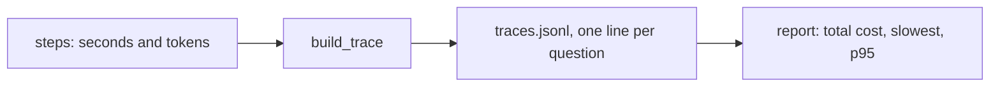

# Trace the cost

## The problem

Nobody knows what one question costs. A manager asks "why is the desk slow today?" and no one can say which step
is slow. For example, one answer used 5,000 tokens and took four seconds, and most of that was one step. Without a
trace, you guess. With one, you read a line.

## Your challenge

This folder holds `trace.py`. It has three TODOs: `build_trace`, `append_to_log` and `report`.

1. In `build_trace`, add up the seconds and tokens over the steps. Price input and output tokens apart. Name the
   slowest step.
2. In `append_to_log`, add one JSON line per question. Never erase old lines.
3. In `report`, give the total cost, the slowest question, and the 95th percentile of seconds. That number says
   "nineteen questions in twenty were this fast or faster".

Try one question:

```bash
echo '{"question": "How many orders?", "steps": [{"name": "route", "seconds": 0.4, "tokens_in": 300, "tokens_out": 20}]}' | uv run python parts/05-build-the-loop/05-trace-the-cost/problem/trace.py trace --log /tmp/traces.jsonl
```

Expect: `"slowest_step": "route"` and a `cost_usd` once `build_trace` is done.



## Done when

- A trace adds up seconds and tokens over every step.
- The cost prices input and output tokens apart.
- The trace names the slowest step, and an empty question does not crash.
- Every question adds one line to the log.
- The report gives the total cost, the slowest question and the 95th percentile.

```bash
bun run verify trace-the-cost
```

Expect: `Done. All 6 rules pass.`

## If you get stuck

| What you see                             | Fix                                                                        |
| ---------------------------------------- | -------------------------------------------------------------------------- |
| `FAIL ... prices input and output apart` | Use the input price for `tokens_in` and the output price for `tokens_out`. |
| `FAIL ... adds one line to the log`      | Open the file with `"a"`, not `"w"`.                                       |
| `FAIL ... 95th percentile`               | Sort first. Then take index `ceil(0.95 * count) - 1`.                      |

## Words you will use

- **Trace**: a record of one question: its steps, time, tokens and cost.
- **Token**: a small piece of text that a model reads or writes. Models charge by the token.
- **95th percentile**: the time that 95 of every 100 questions beat.
