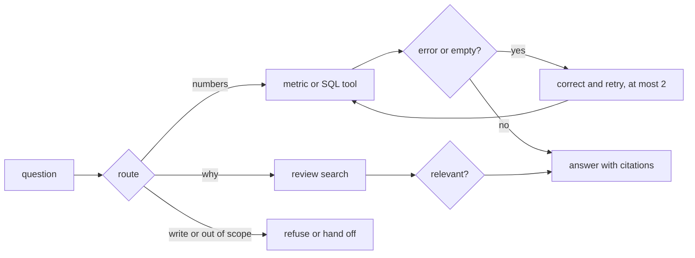

# Build the loop

This part is planned. Its steps are built by a later session; the table below is the contract for that work.

## The problem

A pipeline that always runs SQL cannot answer "what do their reviews say", and one that always searches cannot
count. LinkedIn reports that "Fix with AI" accounts for 80% of SQL Bot sessions, so repairing an error is the main
path, not an edge case
([LinkedIn Engineering](https://www.linkedin.com/blog/engineering/ai/practical-text-to-sql-for-data-analytics)).
An answer without citations cannot be checked by the category manager.



## Steps

45 minutes in 4 steps.

| Step                  | Minutes | You produce                                                                 | The check reads                                                                                                |
| --------------------- | ------- | --------------------------------------------------------------------------- | -------------------------------------------------------------------------------------------------------------- |
| `route-the-question`  | 12      | a router: sql, reviews, both, refuse or handoff                             | `route` in `ask --json` matches the expected route for at least 36 of 40 questions                             |
| `correct-the-error`   | 10      | on a SQL error or empty result the agent rewrites and retries at most twice | with a broken column name injected, at least 4 of 5 answers still match; the query log shows at most 2 retries |
| `check-the-relevance` | 8       | a relevance check on review hits                                            | none of 5 seeded off-topic reviews is cited                                                                    |
| `cite-the-rows`       | 15      | every number cites a query id and row ids; every quote cites a `review_id`  | re-running each cited query reproduces the number; every cited review contains its quote                       |

## Walkthrough

TODO(part session): one command per step, each with its Expect line.

```bash
bun run verify part build-the-loop
```

Expect: `Part build-the-loop is done: 4/4 steps pass.` once the steps exist.
