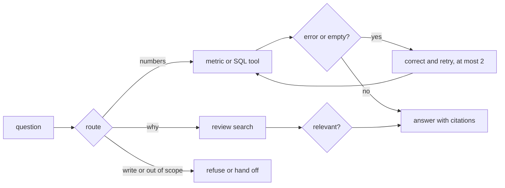

# Build the loop

## The problem

Some questions need numbers, and some need words. A pipeline that always runs SQL cannot answer "what do their
reviews say". A pipeline that always searches text cannot count.

For example, "Which Sao Paulo sellers had the most late deliveries in 2018?" needs both. The finished agent's plan
for it has the route `both`. It counts late orders with SQL, then quotes reviews from those orders.

SQL errors are normal, so the agent must fix its own queries. It must also know when to stop trying.

An answer also needs citations. A citation points to the exact query or review behind a claim. Without
citations, the category manager cannot check the answer.

Anthropic automates 95% of its business analytics questions with Claude, at about 95% accuracy. It still names
one failure it cannot fully catch: an answer that is wrong but looks right. One of its fixes is a footer on every
answer that says where the answer came from
([Anthropic](https://claude.com/blog/how-anthropic-enables-self-service-data-analytics-with-claude)).



## How the steps run

Each step has one small Python program in its `problem/` folder. You change that program. The helpers it uses
are in `kit.py` in this folder, and the test data is in `kit.toml`.

You run a step's program with `kit.py` and the step name. For example:

```bash
uv run python parts/05-build-the-loop/kit.py route-the-question "Delete the test orders"
```

Expect: `{"question": "Delete the test orders", "route": "sql"}` before you start, and `"route": "refuse"` when
your router works.

Add `--folder solution` after the step name to run the sample solution instead.

## Steps

45 minutes in 4 steps.

| Step                                                            | Minutes | You produce                                                          | The check reads                                                                                        |
| --------------------------------------------------------------- | ------- | -------------------------------------------------------------------- | ------------------------------------------------------------------------------------------------------ |
| [route-the-question](01-route-the-question/problem/README.md)   | 12      | `router.py`: sql, reviews, both, refuse or handoff                   | the route your router prints for 40 questions; at least 36 match, every write is refused               |
| [correct-the-error](02-correct-the-error/problem/README.md)     | 10      | `retry.py`: on an error or no rows, rewrite and retry at most twice  | 5 broken queries, 3 runs: at least 4 answers match the golden rows; the ledger shows at most 2 retries |
| [check-the-relevance](03-check-the-relevance/problem/README.md) | 8       | `relevance.py`: a relevance check on review hits                     | the review ids your answer cites; none of the 5 off-topic reviews is among them                        |
| [cite-the-rows](04-cite-the-rows/problem/README.md)             | 15      | `cite.py`: every number cites a query and rows; every quote a review | every cited query, run again; every cited review, looked up                                            |

## Walkthrough

Run these commands in order. Each one prints the line under it when your work is right.

```bash
bun run verify route-the-question
```

Expect: `Done. All 6 rules pass.`

```bash
uv run python parts/05-build-the-loop/kit.py correct-the-error "How many orders were delivered?"
```

Expect: a JSON line with `"rows": [[96478]]` and `"error": null`.

```bash
bun run verify correct-the-error
```

Expect: `Done. All 5 rules pass.`

```bash
bun run verify check-the-relevance
```

Expect: `Done. All 4 rules pass.`

```bash
uv run python parts/05-build-the-loop/kit.py cite-the-rows "Which Sao Paulo sellers had the most late deliveries in 2018?"
```

Expect: the answer, then `Sources:` with 17 numbered lines, ending with three review quotes.

```bash
bun run verify cite-the-rows
```

Expect: `Done. All 5 rules pass.`

```bash
bun run verify part build-the-loop
```

Expect: `Part build-the-loop is done: 4/4 steps pass.`

## Assignment

**The problem.** A pipeline that always runs SQL cannot say why.

**What you hand in.** A commit on your repo with your router, the retry loop with at most 2 retries, the
relevance check, and citations.

**How it is checked.** Each line is yes or no:

1. Does `bun run verify route-the-question` pass, with at least 36 of 40 routes right?
2. Does `bun run verify correct-the-error` pass, with at least 4 of 5 answers right?
3. Does `bun run verify check-the-relevance` pass?
4. Does `bun run verify cite-the-rows` pass?

**Extension, not graded.** Add a reviewer pass: a second model call that checks each answer before it goes out.
Record how accuracy, tokens and time change. Anthropic reports that its adversarial review added 6% accuracy for
32% more tokens and 72% more time
([Anthropic](https://claude.com/blog/how-anthropic-enables-self-service-data-analytics-with-claude)).

## Finished

You now have the four parts of an agent loop: a router, a retry loop with a limit, a relevance check and
citations. Every claim in an answer points to rows or a review that a check can look up.

Next, in answer-with-ui, you turn this answer into a screen. The rows become a table and a chart, and the cited
quotes become review cards. The citations you built here are what each card shows.

## Read before or after

- Chen and others, [Text-to-SQL for Enterprise Data Analytics](https://arxiv.org/abs/2507.14372). LinkedIn's SQL
  Bot, with checks before a query runs and the error-repair path.
- [QueryGPT](https://www.uber.com/blog/query-gpt/) from Uber. Why a router comes before the SQL writer.
