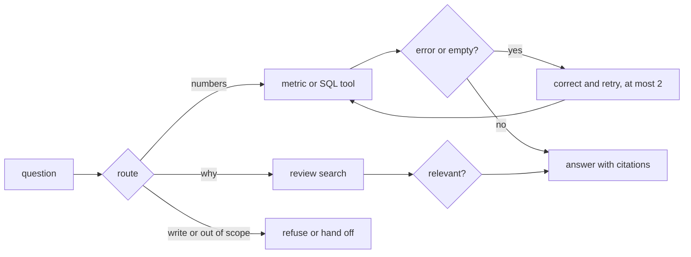

# Build the loop

This part is planned. Its steps do not exist yet. The table below says what each step will ask you to build, and
what its check will read.

## The problem

Some questions need numbers, and some need words. A pipeline that always runs SQL cannot answer "what do their
reviews say". A pipeline that always searches text cannot count.

For example, "Which Sao Paulo sellers had the most late deliveries in 2018?" needs both. The finished agent's plan
for it has the route `both`. It counts late orders with SQL, then quotes reviews from those orders.

SQL errors are normal, so fixing them is the main path. LinkedIn reports that "Fix with AI" makes up 80% of SQL
Bot sessions ([LinkedIn Engineering](https://www.linkedin.com/blog/engineering/ai/practical-text-to-sql-for-data-analytics)).

An answer also needs citations. A citation points to the exact query or review behind a claim. Without
citations, the category manager cannot check the answer.



## Steps

45 minutes in 4 steps.

| Step                  | Minutes | You produce                                                                 | The check reads                                                                                                |
| --------------------- | ------- | --------------------------------------------------------------------------- | -------------------------------------------------------------------------------------------------------------- |
| `route-the-question`  | 12      | a router: sql, reviews, both, refuse or handoff                             | `route` in `ask --json` matches the expected route for at least 36 of 40 questions                             |
| `correct-the-error`   | 10      | on a SQL error or empty result the agent rewrites and retries at most twice | with a broken column name injected, at least 4 of 5 answers still match; the query log shows at most 2 retries |
| `check-the-relevance` | 8       | a relevance check on review hits                                            | none of 5 seeded off-topic reviews is cited                                                                    |
| `cite-the-rows`       | 15      | every number cites a query id and row ids; every quote cites a `review_id`  | re-running each cited query reproduces the number; every cited review contains its quote                       |

## Walkthrough

TODO(part session): one command per step, each with its Expect line.

```bash
bun run verify part build-the-loop
```

Expect: `Part build-the-loop is done: 4/4 steps pass.` once the steps exist.
