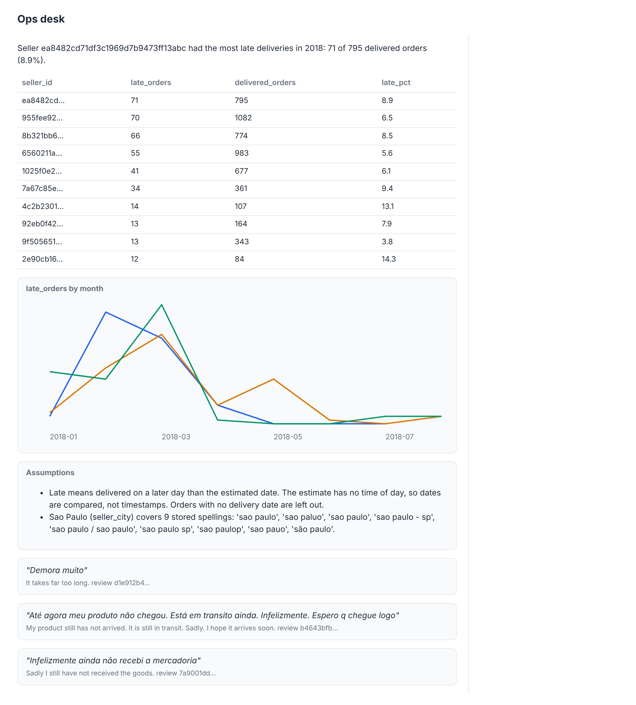

# Render the answer

## The problem

The Sao Paulo answer has 10 rows, a chart of late orders by month, two assumptions and three review quotes. As
text, that is a wall of numbers. A category manager wants a table they can scan, a trend line and the quotes.

The agent could write HTML. But then the browser runs whatever the model wrote, and a check cannot read the rows
back out of it. A2UI sends data instead. The agent picks components from a catalog that the browser already
trusts, and puts the numbers in a data model.



## Your challenge

Open `render.py` in this folder. `surface_for(answer)` already returns two A2UI v1.0 messages:

1. `createSurface`, with the course catalog id and a data model.
2. `updateComponents`, with the components. The one with the id `root` is drawn first.

Today it shows only the answer sentence. Change `data_model_for` and `components_for` so the surface shows the
whole answer. The catalog is in `parts/06-answer-with-ui/catalog.json`. It has `Column`, `Text`, `Table`,
`LineChart`, `AssumptionCard` and `ReviewQuote`.

A component points into the data model with a path. For example, the table for the Sao Paulo answer is:

```json
{
  "id": "table",
  "component": "Table",
  "columns": { "@path": "/table/columns" },
  "rows": { "@path": "/table/rows" }
}
```

The data model then holds `"table": {"columns": ["seller_id", "late_orders", ...], "rows": [[...], ...]}`.

To see every key of the answer, run the command below without `--html`. It prints the answer as JSON. For example,
`answer["chart"]` holds `"x": "month"`, `"y": "late_orders"`, `"series": "seller"`, the `columns` and the `rows`.

A chart needs points, not rows. A point is one row with its column names as keys. So the row
`["2018-01", "8b321bb669392f5163d04c59e235e066", 3]` becomes this point:

```json
{ "month": "2018-01", "seller": "8b321bb669392f5163d04c59e235e066", "late_orders": 3 }
```

The `LineChart` then names its columns: `"x": "month"`, `"y": "late_orders"` and `"series": "seller"`.

```bash
uv run python parts/06-answer-with-ui/kit.py render-the-answer "Which Sao Paulo sellers had the most late deliveries in 2018?" --html answer.html
```

Expect: `Wrote answer.html`. Open it in your browser and compare it with the picture above.

## Done when

- `render.py` prints an answer with a `ui` list for each of the 6 questions.
- Each `ui` starts with `createSurface` (version 1.0, the course catalog), then `updateComponents`.
- Every component is one the course catalog has.
- A `Table` points into the data model, and there it finds every row of the answer.
- The Sao Paulo answer shows its chart and a `ReviewQuote` for each cited review.

```bash
bun run verify render-the-answer
```

Expect: `Done. All 5 rules pass.`

## If you get stuck

| What you see                                      | Fix                                                                   |
| ------------------------------------------------- | --------------------------------------------------------------------- |
| `FAIL a Table points into the data model ...`     | Send every row. The path must start with `/` and match a key you set. |
| `FAIL the Sao Paulo answer shows its chart ...`   | Make one point per row, keyed by column name. Set `x` and `y` too.    |
| The page says a part of the answer did not arrive | Every id in `root`'s `children` needs its own component.              |

## Words you will use

- **Surface**: one area of the screen that the agent fills, like one answer card.
- **Catalog**: the list of components the renderer trusts. The agent may use only these.
- **Data model**: the plain data behind a surface. Components point into it with `{"@path": ...}`.
