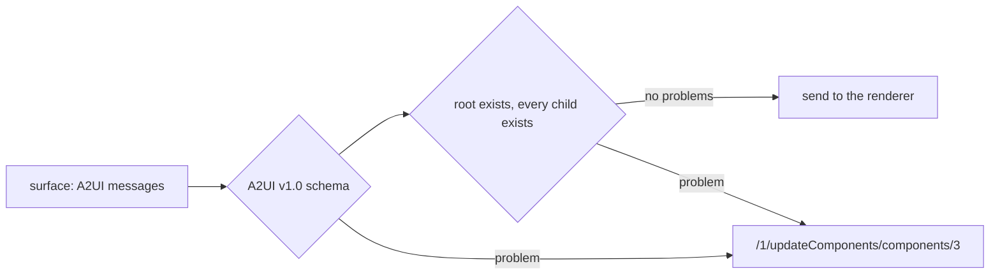

# Validate the surface

## The problem

A model sometimes gets the format wrong. It may name a component the catalog does not have, forget the version,
or put HTML where data should be. If the agent sends that surface, the screen breaks in front of the category
manager. Worse, the error says nothing useful.

So the agent checks every surface before it sends it. When something is wrong, the check says exactly where.



## Your challenge

Open `validate.py` in this folder. Fill in `problems_in(messages)`:

1. Check every message with `kit.schema_problems(index, message)`. It uses the A2UI v1.0 schemas in `schemas/`,
   copied from the A2UI project, and the course catalog.
2. Add two rules the schema cannot see. One component must have the id `root`. Every child id that a `Column`
   names must be a component of the surface.

Each problem is `{"path": ..., "message": ...}`. The path starts with the message number. For example,
`/1/updateComponents/components/0/children/7` means: message 1, its components, item 0, its children, item 7.

The `surfaces/` folder holds 6 good surfaces from golden answers and 5 broken ones. Each broken file says what is
wrong in `broken`, and where in `expected_path`.

```bash
uv run python parts/06-answer-with-ui/kit.py validate-the-surface parts/06-answer-with-ui/02-validate-the-surface/surfaces/bad-missing-child.json
```

Expect: `"valid": false` and the path `/1/updateComponents/components/0/children/7`.

## Done when

- `validate.py` prints a verdict for each of the 11 surfaces.
- Every surface from a golden answer is valid.
- Each of the 5 broken surfaces is rejected.
- Each rejection names the failing JSON path.

```bash
bun run verify validate-the-surface
```

Expect: `Done. All 4 rules pass.`

## If you get stuck

| What you see                                       | Fix                                                                              |
| -------------------------------------------------- | -------------------------------------------------------------------------------- |
| `FAIL each of the 5 broken surfaces ...`           | Check every message, not only the first. Then add the two tree rules.            |
| `FAIL each rejection names the failing JSON path`  | Start the path with `/` and the message number.                                  |
| `FAIL every surface from a golden answer is valid` | A `children` value can also be a template object. Skip it when it is not a list. |

## Words you will use

- **Schema**: a file that says what a valid message looks like. A program can check a message against it.
- **JSON path**: the address of one value inside a JSON document, like `/0/version`.
