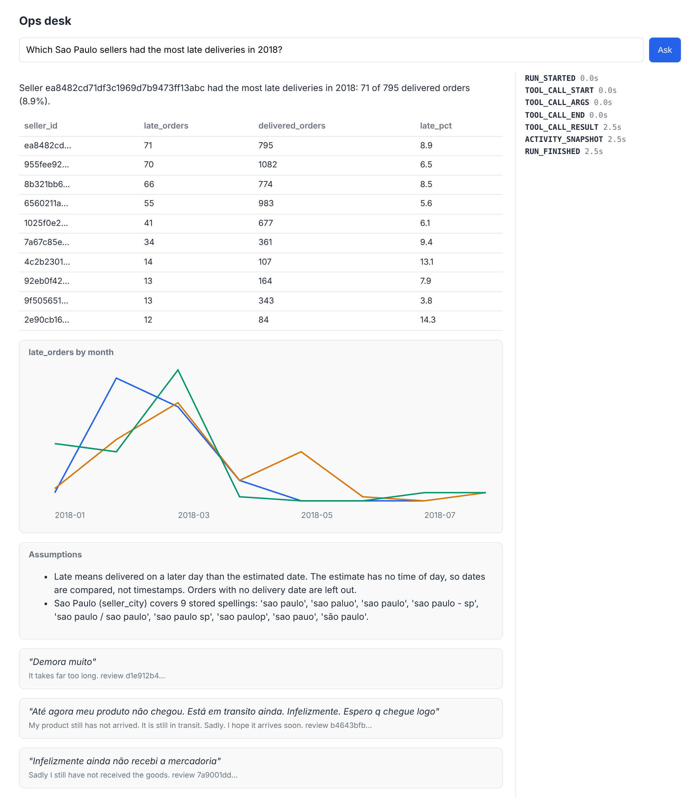

# Stream the events

## The problem

The Sao Paulo answer takes a few seconds: several queries, a review search, and a gloss for each quote. If the
screen stays blank all that time, the category manager clicks again, or leaves.

AG-UI is a protocol for the events between an agent and a screen. The agent sends small events as it works: "the
run started", "a tool is running", "here is the surface", "the run finished". The screen shows progress at once.



## Your challenge

Open `server.py` in this folder. It is a small web server. `POST /ask` already sends each event as
`data: {...}` and a blank line. This is called Server-Sent Events. Change `events_for(question)` so it yields
these AG-UI events, in this order:

| Event               | When                      | Holds                                            |
| ------------------- | ------------------------- | ------------------------------------------------ |
| `RUN_STARTED`       | first, before any work    | `threadId`, `runId`                              |
| `TOOL_CALL_START`   | before the slow work      | `toolCallId`, `toolCallName`                     |
| `TOOL_CALL_ARGS`    | before the slow work      | `toolCallId`, `delta` (the arguments as JSON)    |
| `TOOL_CALL_END`     | after the slow work       | `toolCallId`                                     |
| `TOOL_CALL_RESULT`  | right after the call ends | `toolCallId`, `content`                          |
| `ACTIVITY_SNAPSHOT` | after the result          | `"activityType": "a2ui-surface"` and the surface |
| `RUN_FINISHED`      | last                      | the same `threadId` and `runId`                  |

The surface comes from your `render.py` in render-the-answer. For example, the check slows the database to 3
seconds. With the right order, `RUN_STARTED` still arrives in less than a second.

```bash
uv run python parts/06-answer-with-ui/kit.py stream-the-events
```

Expect: `Ops desk on http://localhost:8006`. Open that address, press Ask, and watch the events appear. Stop the
server with Ctrl+C.

## Done when

- `POST /ask` with `Accept: text/event-stream` answers as an event stream.
- The run starts with `RUN_STARTED` and ends with `RUN_FINISHED` for the same run.
- One tool call is sent in order: start, arguments, end, then its result.
- The tool call starts before the slow work and ends after it, so the screen never says "done" too soon.
- The A2UI surface arrives in an `a2ui-surface` activity before `RUN_FINISHED`.
- The first event arrives within 2 seconds, while the database takes 3.

```bash
bun run verify stream-the-events
```

Expect: `Done. All 6 rules pass.` The check starts your server, asks one question, and stops it again.

## If you get stuck

| What you see                                            | Fix                                                            |
| ------------------------------------------------------- | -------------------------------------------------------------- |
| `FAIL the first event arrives within 2 seconds`         | Yield `RUN_STARTED` before you call `kit.finished_answer`.     |
| `FAIL the A2UI surface arrives ... before RUN_FINISHED` | `RUN_FINISHED` is always the last event of a run.              |
| `FAIL the tool call ends only after the work`           | Yield `TOOL_CALL_END` after `kit.finished_answer`, not before. |
| `Address already in use`                                | Another server runs on 8006. Stop it, or add `--port 8007`.    |

## Words you will use

- **Event stream**: one long answer that arrives in pieces, one event at a time.
- **Run**: one question and everything the agent does to answer it.
- **Tool call**: one action the agent takes, like asking the database.
