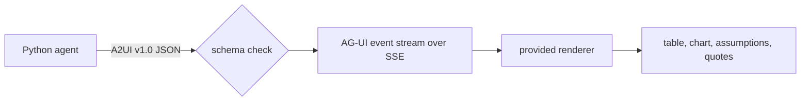

# Answer with UI

This part is planned. Its steps do not exist yet. The table below says what each step will ask you to build, and
what its check will read.

## The problem

A category manager does not want to read a paragraph with twelve numbers in it. A security team will not accept an
agent that sends HTML or JavaScript to the browser.

A2UI solves both. It is a format that sends data, not code. The agent picks parts of the screen from a list the
browser already trusts ([A2UI](https://a2ui.org/)). A2UI reports that Google Opal uses it for hundreds of
thousands of people.

You write Python only. The course gives you the code that draws the screen.

For example, the finished agent's answer about late deliveries in Sao Paulo shows four parts: a table of sellers,
a chart of late orders by month, the assumptions, and three quoted reviews. You saw it in `answer.html` in the
orientation.



## Steps

40 minutes in 3 steps.

| Step                   | Minutes | You produce                                                                                | The check reads                                                                           |
| ---------------------- | ------- | ------------------------------------------------------------------------------------------ | ----------------------------------------------------------------------------------------- |
| `render-the-answer`    | 15      | A2UI v1.0 messages using the course catalog: Table, LineChart, AssumptionCard, ReviewQuote | for 5 golden questions the `ui` data model holds the same rows as `rows`                  |
| `validate-the-surface` | 10      | a schema check against the A2UI v1.0 JSON schemas pinned in `checks/schemas/`              | 5 broken surfaces are rejected with the failing JSON path; every golden surface validates |
| `stream-the-events`    | 15      | `POST /ask` streams AG-UI events                                                           | the SSE stream has the events in a valid order; the first event arrives within 2 seconds  |

## Walkthrough

TODO(part session): one command per step, each with its Expect line.

```bash
bun run verify part answer-with-ui
```

Expect: `Part answer-with-ui is done: 3/3 steps pass.` once the steps exist.
