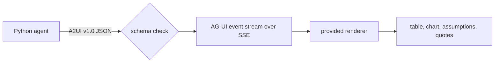

# Answer with UI

## The problem

A category manager does not want to read a paragraph with twelve numbers in it. A security team will not accept an
agent that sends HTML or JavaScript to the browser.

A2UI solves both. It is a format that sends data, not code. The agent picks parts of the screen from a list the
browser already trusts. That list is called a catalog. A check can read every row back out of the surface.

AG-UI then carries the answer to the screen as small events. The screen shows progress while the agent still
works.

You write Python only. The course gives you the page that draws the screen: `renderer.html` in this folder.

For example, the finished agent's answer about late deliveries in Sao Paulo shows four parts: a table of sellers,
a chart of late orders by month, the assumptions, and three quoted reviews. You saw it in `answer.html` in the
orientation. In this part you build the same screen from A2UI messages.



## How the steps run

Each step has one small Python program in its `problem/` folder. You change that program. The helpers it uses
are in `kit.py` in this folder. The course catalog is `catalog.json`.

You run a step's program with `kit.py` and the step name. Add `--folder solution` after the step name to run the
sample solution instead.

## Steps

40 minutes in 3 steps.

| Step                                                              | Minutes | You produce                                                                        | The check reads                                                                              |
| ----------------------------------------------------------------- | ------- | ---------------------------------------------------------------------------------- | -------------------------------------------------------------------------------------------- |
| [render-the-answer](01-render-the-answer/problem/README.md)       | 15      | `render.py`: A2UI v1.0 messages with Table, LineChart, AssumptionCard, ReviewQuote | for 5 golden questions and the Sao Paulo question, the rows the table points to equal `rows` |
| [validate-the-surface](02-validate-the-surface/problem/README.md) | 10      | `validate.py`: a check against the pinned A2UI v1.0 schemas, plus two tree rules   | 5 broken surfaces rejected with the failing JSON path; 6 golden surfaces valid               |
| [stream-the-events](03-stream-the-events/problem/README.md)       | 15      | `server.py`: `POST /ask` streams AG-UI events                                      | the event order in the stream, and that the first event arrives within 2 seconds             |

## Walkthrough

Run these commands in order. Each one prints the line under it when your work is right.

```bash
uv run python parts/06-answer-with-ui/kit.py render-the-answer "Which Sao Paulo sellers had the most late deliveries in 2018?" --html answer.html
```

Expect: `Wrote answer.html`. The page shows a table, a chart, the assumptions and three quotes.

```bash
bun run verify render-the-answer
```

Expect: `Done. All 5 rules pass.`

```bash
bun run verify validate-the-surface
```

Expect: `Done. All 4 rules pass.`

```bash
bun run verify stream-the-events
```

Expect: `Done. All 5 rules pass.`

```bash
bun run verify part answer-with-ui
```

Expect: `Part answer-with-ui is done: 3/3 steps pass.`

## Assignment

**The problem.** A category manager will not read twelve numbers in a paragraph.

**What you hand in.** A commit on your repo with your A2UI surfaces, the schema check and the AG-UI stream.

**How it is checked.** Each line is yes or no:

1. Does `bun run verify render-the-answer` pass?
2. Does `bun run verify validate-the-surface` pass, with 5 of 5 broken surfaces rejected?
3. Does `bun run verify stream-the-events` pass?

**Extension, not graded.** Add one component to `catalog.json` and draw it in `renderer.html`. For example, a
`Metric` card that shows one big number. Then add a broken surface for it to `surfaces/` and show that your
check rejects it.

## Finished

Your agent's answer is now a screen. The rows are a table, the trend is a chart, and every quote is a card with
its review id. Every surface is checked before it is sent, and the events arrive while the agent works.

Next, in approve-the-write, the screen shows a new kind of surface: an approval form. When someone asks to pause
a seller, the run ends with a question to a person, and nothing changes until that person says yes.

## Read before or after

- [A2UI specification v1.0](https://a2ui.org/specification/v1.0-a2ui/). The messages the agent sends, and why a
  catalog makes the screen data, not code.
- [AG-UI events](https://docs.ag-ui.com/concepts/events). The event types used in stream-the-events.
- [MCP Apps](https://blog.modelcontextprotocol.io/posts/2026-01-26-mcp-apps/). Another way to show a UI, inside
  Claude Desktop. It sends HTML in a sandbox, so this course shows it here and does not build on it.
