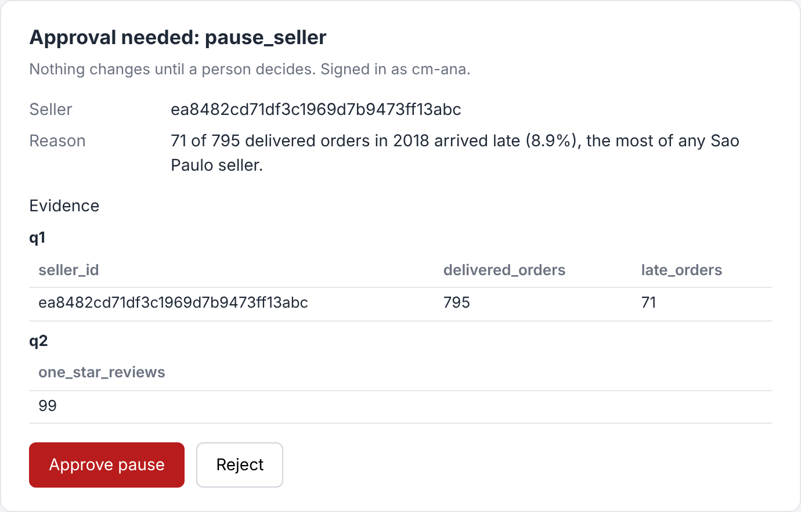

# Ask before pausing

## The problem

Pausing a seller stops their sales, and so their income. The agent can find the evidence and draft the action.
But a named person must decide. Until then, nothing changes.

The model may even write "approved": true in its plan. For example, the recorded plan for "Pause seller
ea8482cd, too many late deliveries in 2018" says `"approved": true`. That is the model's word, not a person's.



## Your challenge

Open `approve.py` in this folder. It has two commands:

- `ask "<question>" --user cm-ana` runs `ask(question, user)`.
- `resume <id> --approve` (or `--reject`) `--user cm-ana` runs `resume(interrupt_id, approved, user)`.

Today `ask` pauses the seller at once. Change the two functions:

1. In `ask`, do not pause. Save the run with `kit.save_pending(interrupt_id, run)`. Return the form from
   `kit.approval_form_surface(plan, evidence)` as `"ui"`. End the run with an interrupt:
   `"outcome": {"type": "interrupt", "interrupts": [{"id": interrupt_id, "reason": "approval"}]}`.
2. In `resume`, load the run with `kit.load_pending(interrupt_id)`. Forget it with `kit.forget_pending`, so a
   second resume finds nothing. Call `kit.pause_seller` only when `approved` is `True`.

This is the shape of an AG-UI interrupt: the run ends, and a new run resumes it with the person's answer.

```bash
uv run python parts/07-approve-the-write/kit.py ask-before-pausing ask "Pause seller ea8482cd, too many late deliveries in 2018" --user cm-ana
```

Expect: a JSON line with `"type": "interrupt"` and an id like `approval-1a2b3c4d5e6f`. Then resume it:

```bash
uv run python parts/07-approve-the-write/kit.py ask-before-pausing resume approval-1a2b3c4d5e6f --approve --user cm-ana
```

Expect: `"approved": true`, and one new line in `data/logs/seller_api.jsonl`. Use the id the first command printed.

## Done when

- Asking to pause a seller ends with an interrupt and an approval form with the evidence.
- Without a decision, the seller-success API is never called.
- After an approval, the API holds exactly one pause call for that seller.
- After a rejection, the API is never called.
- The same approval sent twice still makes only one call.

```bash
bun run verify ask-before-pausing
```

Expect: `Done. All 5 rules pass.`

## If you get stuck

| What you see                                | Fix                                                                           |
| ------------------------------------------- | ----------------------------------------------------------------------------- |
| `FAIL without a decision, ... never called` | Remove every `kit.pause_seller` from `ask`, even when the plan says approved. |
| `FAIL the same approval sent twice ...`     | Call `kit.forget_pending(interrupt_id)` before you pause.                     |
| `no run waits for this decision`            | Copy the id from the `ask` output; each `ask` makes a new one.                |

## Words you will use

- **Interrupt**: a run that ends because it needs a person's answer before it can go on.
- **Resume**: a new run that carries the person's answer to the interrupt.
- **Mock API**: a stand-in for another team's system. It records each call instead of doing it.
